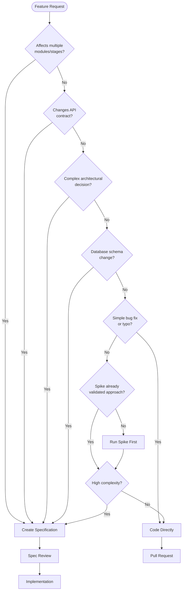
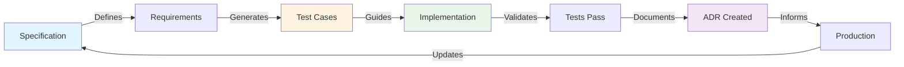
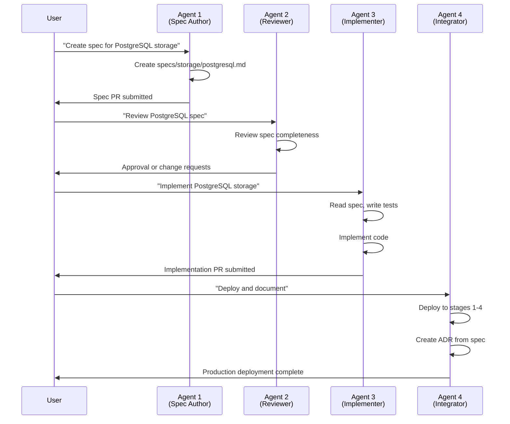
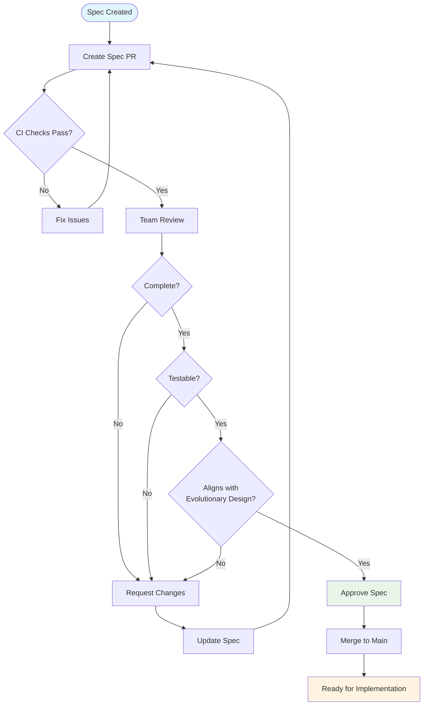

# Specification-Driven Development (SDD) for FRANK

- **Status:** Integrated workflow for FRANK team
- **Last Updated:** 2026-02-06
- **Related:** [CLAUDE.md](CLAUDE.md), [docs/evolutionary_design.md](docs/evolutionary_design.md), [ADR-0011: Spike Integration Process](docs/adr/0011-spike-integration-process.md)

## Overview

Specification-Driven Development (SDD) is FRANK's approach to designing complex features before implementing them. SDD complements our evolutionary design philosophy by providing a lightweight specification layer that bridges exploration (spikes) and production implementation. The workflow ensures that complex architectural decisions are documented, reviewed, and validated before significant development effort is invested.

**Key Principle:** Specifications are living design documents that capture intent, constraints, and contracts. They guide implementation, inform testing, and eventually become Architectural Decision Records (ADRs) once deployed.

## Philosophy: How SDD Complements Evolutionary Design

FRANK's evolutionary design philosophy emphasizes:
- Structured evolution over big-bang development
- One complexity dimension at a time
- Working systems at every stage
- Comprehensive testing enables confident experimentation

**SDD enhances this philosophy by:**

1. **Reducing Risk Before Implementation** - Specifications force architectural thinking before coding
2. **Enabling Parallel Work** - Multiple team members can implement against a shared spec
3. **Facilitating Review** - Specs are easier to review than implementation PRs
4. **Capturing Context** - Design rationale is preserved for future maintainers
5. **Supporting AI Agents** - Specifications provide clear contracts for AI-assisted development

**SDD does NOT replace:**
- Spike tests for hypothesis-driven exploration
- Unit/integration tests for validation
- ADRs for architectural decision records
- Working code as the ultimate source of truth

## When to Create Specs vs When to Code Directly



### Always Create a Spec For

**Infrastructure Changes:**
- New database implementations (e.g., PostgreSQL, ScyllaDB)
- Storage layer refactoring affecting multiple stages
- Authentication/authorization mechanism changes
- API versioning or breaking changes

**Cross-Cutting Features:**
- Features affecting multiple stages (Stage 1-4)
- Changes to core data models (Observable, Submission, Sighting)
- Access tier filtering modifications
- Multi-component integrations

**Performance-Critical Components:**
- Query optimization strategies
- Caching layer design
- Rate limiting implementation
- Auto-scaling policies

**Security-Sensitive Features:**
- Authentication flows
- Token management
- Data privacy controls (HitTarget masking)
- Audit logging mechanisms

### Code Directly For

**Simple Changes:**
- Bug fixes (unless architectural root cause)
- Typo corrections
- Documentation updates
- Comment improvements
- Dependency version bumps

**Well-Established Patterns:**
- Adding new observable types (pattern exists)
- New API endpoint following existing patterns
- Additional unit tests
- Logging statements

**Spike-Validated Approaches:**
- Implementation of patterns already validated in spikes
- Low-complexity integration of spike learnings
- Following spike README integration guidance

## Workflow: Spec → Test → Code → ADR



### Step 1: Create Specification

**Location:** `specs/[category]/[feature-name].md`

**Categories:**
- `core/` - Data models, enums, domain logic
- `storage/` - Database implementations, queries
- `api/` - REST endpoints, request/response contracts
- `auth/` - Authentication, authorization patterns
- `infrastructure/` - Deployment, scaling, monitoring

**Template:** Use `specs/templates/feature.md` or `specs/templates/change-proposal.md`

**Key Sections:**
- **Overview** - What problem does this solve?
- **Requirements** - Functional and non-functional requirements
- **Design** - Architecture, data flow, components
- **Contracts** - API signatures, data schemas, interfaces
- **Testing Strategy** - How will this be validated?
- **Rollout Plan** - Phased deployment across stages

**Example:**
```markdown
# Specification: PostgreSQL Management API Storage

## Overview
Implement PostgreSQL backend for Management API to separate organization/member
management from threat intelligence data (DynamoDB).

## Requirements
- MUST support all organization CRUD operations
- MUST handle member management with role assignments
- MUST store refresh tokens for logout tracking
- MUST NOT handle threat intelligence operations

## Design
See [ADR-0009: PostgreSQL Management API](docs/adr/0009-postgresql-management-api.md)

## Contracts
See `src/frank/storage/base.py` - implement:
- upsert_organisation()
- get_organisation_by_id()
- list_organisations()
- [10 more methods...]
```

### Step 2: Generate Test Cases from Requirements

Requirements in the spec directly translate to test cases:

**Requirement → Unit Test:**
```markdown
# Spec requirement
MUST validate IPv4 addresses with proper CIDR notation

# Unit test
def test_ipv4_cidr_validation():
    obs = Observable.create_ipv4("192.168.1.0/24")
    assert obs.value == "192.168.1.0/24"
    assert obs.type == ObservableType.IPV4_CIDR
```

**Requirement → Integration Test (BDD):**
```markdown
# Spec requirement
MUST enforce access tier filtering - OBSERVER cannot see CONTRIBUTOR data

# BDD feature
Scenario: Observer cannot see contributor sightings
  Given I am authenticated as an observer user
  When I query for sightings with IP address "192.168.1.100"
  Then I should receive masked data
  And contributor fields should be filtered
```

**Requirement → Spike Test:**
```markdown
# Spec requirement
MUST validate AWS Cognito JWT tokens with RS256

# Spike test (tests/spikes/014_cognito/)
def test_cognito_jwt_validation():
    token = generate_cognito_token(groups=["contributor"])
    payload = validate_jwt_rs256(token, jwks_url)
    assert payload["username"] == "test-user"
```

### Step 3: Implement Against Contract

**Contract-First Implementation:**
1. Define interface/abstract base class in spec
2. Implement interface with TDD (test → code → refactor)
3. Ensure implementation passes all tests from Step 2
4. Verify against spec requirements checklist

**Example:**
```python
# Spec defines contract
class BaseFRANKDatabase(ABC):
    @abstractmethod
    def store_submission(self, submission: Submission) -> None:
        """Store threat intelligence submission with access filtering"""
        pass

# Implementation follows contract
class PostgreSQLDatabase(BaseFRANKDatabase):
    def store_submission(self, submission: Submission) -> None:
        # Actual implementation matching contract
        pass
```

### Step 4: Validate and Deploy

**Validation Checklist:**
- [ ] All unit tests pass (≥85% coverage)
- [ ] Integration tests pass (BDD scenarios)
- [ ] Spec requirements met (manual checklist review)
- [ ] Code review completed
- [ ] Documentation updated

**Deployment:**
- Merge feature branch to main
- Deploy to Stage 1 (local) → Stage 2 (LocalStack) → Stage 3 (AWS Dev) → Stage 4 (prod)
- Monitor health checks and logs

### Step 5: Create ADR from Spec

**When:** After successful deployment and validation in production

**Process:**
1. Copy spec to `docs/adr/NNNN-title.md`
2. Add ADR metadata (Status: accepted, Date, Decision Makers)
3. Add "Decision Outcome" section with rationale
4. Add "Positive/Negative Consequences" from production experience
5. Link spec to ADR and vice versa

**Example:**
```markdown
# ADR-0009: PostgreSQL Management API Storage

Status: accepted
Date: 2026-01-28
Related: specs/storage/postgresql-management.md

## Decision Outcome
Chosen PostgreSQL for Management API because it provides ACID transactions
for organization/member operations while allowing DynamoDB to scale
independently for high-volume threat data.

## Positive Consequences
- Clear separation of concerns (management vs threat data)
- PostgreSQL ACID transactions prevent org data corruption
- DynamoDB scales independently without RDS bottleneck

## Negative Consequences
- Dual database adds operational complexity
- Requires coordination between DynamoDB and PostgreSQL for queries
```

## Integration with Git Worktree Workflow

FRANK uses git worktrees for parallel development. SDD integrates seamlessly:

### Worktree + Spec Workflow

```bash
# 1. Create specification in main worktree
cd ~/wc/FRANK
git checkout -b spec/postgresql-management
# Create specs/storage/postgresql-management.md
git add specs/storage/postgresql-management.md
git commit -m "spec: PostgreSQL management API storage design"
git push -u origin spec/postgresql-management

# 2. Review and approve spec (GitHub PR)
# Team reviews spec, discusses design, approves

# 3. Create implementation worktree
git worktree add ../worktree-agent-2/postgres-impl feat/postgresql-management
cd ../worktree-agent-2/postgres-impl
make dev  # Setup independent virtualenv (.frank/)
venv      # Activate environment

# 4. Implement against spec
# Read specs/storage/postgresql-management.md
# Write tests first (TDD)
pytest tests/unit/storage/test_postgresql.py
# Implement src/frank/storage/postgresql.py

# 5. Validate and deploy
make test  # All tests pass
git add tests/ src/
git commit -m "feat: implement PostgreSQL management API storage"
git push -u origin feat/postgresql-management

# 6. Merge and create ADR
# PR merged to main
# Create docs/adr/0009-postgresql-management-api.md
```

**Key Benefits:**
- Spec reviewed before implementation starts
- Multiple agents can implement in parallel worktrees
- Each worktree has isolated environment (.frank/)
- Spec provides shared context across worktrees

## Integration with Agent Swarm Workflow

FRANK development uses multiple AI agents working in parallel git worktrees. SDD provides essential coordination:

### Agent Roles in SDD

**Agent 1: Specification Author**
- Creates initial spec from requirements
- Structures design and contracts
- Defines testing strategy
- Submits spec PR for review

**Agent 2: Spec Reviewer**
- Reviews spec for completeness
- Identifies missing requirements
- Suggests architectural improvements
- Approves spec for implementation

**Agent 3: Implementation Agent**
- Reads approved spec
- Implements tests from requirements
- Codes against contract
- Validates implementation against spec

**Agent 4: Integration Agent**
- Deploys across stages (1-4)
- Monitors production behavior
- Creates ADR from spec + production learnings
- Updates spec with production insights

### Agent Coordination Pattern



### Agent Swarm Best Practices

**1. Spec as Contract:** All agents reference the spec as source of truth
**2. Parallel Work:** Agents 3 and 4 can work in separate worktrees
**3. Context Preservation:** Specs prevent context loss between agent sessions
**4. Clear Handoffs:** Spec completion = handoff to implementation agent
**5. Validation:** Agent 4 validates implementation matches spec before ADR creation

## Spec Review and Approval Process



### Review Checklist

**Completeness:**
- [ ] Problem statement clearly defined
- [ ] Requirements documented (functional & non-functional)
- [ ] Design includes architecture diagrams
- [ ] Contracts specified (APIs, data schemas, interfaces)
- [ ] Testing strategy defined
- [ ] Rollout plan documented

**Quality:**
- [ ] Requirements are testable (can write tests from requirements)
- [ ] Design aligns with FRANK's evolutionary philosophy
- [ ] Maintains separation of infrastructure and functional complexity
- [ ] Considers all four stages (Stage 1-4 compatibility)
- [ ] Follows repository pattern for database changes
- [ ] Respects access tier filtering requirements

**Feasibility:**
- [ ] Implementation effort estimated (story points/hours)
- [ ] Dependencies identified (other specs, spikes, libraries)
- [ ] Risks documented with mitigation strategies
- [ ] Rollback plan defined

**Team Alignment:**
- [ ] Reviewed by at least 2 team members
- [ ] Architectural concerns addressed
- [ ] Naming conventions agreed upon
- [ ] Performance implications understood

### Approval Workflow

1. **Author Creates Spec PR**
   - Branch: `spec/feature-name`
   - Title: `spec: Brief description`
   - Body: Link to issue, summary of changes

2. **CI Validates Spec**
   - Markdown linting
   - Broken link detection
   - Template compliance check

3. **Team Reviews (2+ reviewers)**
   - Comment on completeness, design, testability
   - Request changes if needed
   - Approve when satisfied

4. **Merge to Main**
   - Squash commits for clean history
   - Spec now ready for implementation

5. **Implementation PR References Spec**
   - Implementation PR links to spec: "Implements specs/storage/postgresql.md"
   - Reviewer validates implementation matches spec

## Examples of Good and Bad Spec Usage

### Good Example 1: PostgreSQL Management API (Major Change)

**Scenario:** Adding PostgreSQL backend for organization/member management

**Spec Created:** `specs/storage/postgresql-management.md`

**Why Good:**
- Complex architectural change affecting multiple components
- Clear separation of concerns (DynamoDB for threat data, PostgreSQL for management)
- Defined contract (BaseFRANKDatabase methods)
- Testing strategy specified (unit + integration tests)
- Rollout plan: Stage 1 (SQLite) → Stage 2 (LocalStack) → Stage 3 (AWS RDS)

**Outcome:**
- Spec reviewed by 3 team members
- Implementation matched spec exactly
- Deployed successfully across all stages
- Became ADR-0009 after production validation

### Good Example 2: Observable Type Extension (Medium Change)

**Scenario:** Adding new observable types (URL, Email, File Hash)

**Spec Created:** `specs/core/observable-types-extension.md`

**Why Good:**
- Affects core data model used across all stages
- Requires STIX ID format validation
- Database schema migration needed (SQLite, DynamoDB, PostgreSQL)
- Access tier filtering implications documented

**Outcome:**
- Clear requirements → unit tests → implementation
- BDD scenarios written from spec
- Smooth rollout across stages

### Good Example 3: Rate Limiting (Complex Feature)

**Scenario:** Implement API rate limiting to prevent abuse

**Spec Created:** `specs/api/rate-limiting.md`

**Why Good:**
- Performance-critical feature
- Multiple strategies evaluated (token bucket, sliding window)
- Testing strategy includes load testing
- Rollout plan: Stage 1 (in-memory) → Stage 3 (Redis)

### Bad Example 1: Typo Fix (Over-Engineering)

**Scenario:** Fix typo in error message

**Spec Created:** ❌ `specs/bugfix/error-message-typo.md`

**Why Bad:**
- Trivial change doesn't warrant spec
- No architectural decision needed
- Slows down simple fix
- Creates unnecessary overhead

**Better Approach:** Code directly, submit PR

### Bad Example 2: Existing Pattern (Redundant)

**Scenario:** Add new API endpoint following existing pattern

**Spec Created:** ❌ `specs/api/new-endpoint.md`

**Why Bad:**
- Pattern already established in codebase
- No new architectural decisions
- Implementation obvious from existing code
- Spec duplicates existing API design

**Better Approach:** Implement following existing pattern, reference existing endpoints in PR description

### Bad Example 3: Premature Spec (Before Spike)

**Scenario:** Evaluate ScyllaDB for Stage 4 without spike

**Spec Created:** ❌ `specs/storage/scylladb-implementation.md`

**Why Bad:**
- Technology not validated yet
- Spec makes assumptions about ScyllaDB behavior
- Should run spike first to validate hypothesis
- Spec will need major revision after spike learnings

**Better Approach:**
1. Run spike: `tests/spikes/NNN_scylladb/`
2. Validate hypothesis and learn patterns
3. Create spec based on spike results
4. Implement production code

## Integration with CI/CD

### Spec Validation Pipeline

```yaml
# .github/workflows/spec-validation.yml
name: Spec Validation

on:
  pull_request:
    paths:
      - 'specs/**/*.md'

jobs:
  validate:
    runs-on: ubuntu-latest
    steps:
      - name: Check markdown linting
        run: markdownlint specs/

      - name: Validate spec template compliance
        run: python tools/validate_spec.py specs/

      - name: Check broken links
        run: markdown-link-check specs/**/*.md

      - name: Ensure requirements testable
        run: python tools/check_testable_requirements.py specs/
```

### Spec-to-Test Traceability

```python
# tools/check_testable_requirements.py
def validate_spec_has_tests(spec_path: str):
    """Ensure each requirement in spec has corresponding test"""
    requirements = extract_requirements(spec_path)
    test_files = find_related_tests(spec_path)

    for req in requirements:
        if not has_test_for_requirement(req, test_files):
            raise SpecValidationError(
                f"Requirement '{req}' has no corresponding test"
            )
```

### Implementation Validation

```yaml
# .github/workflows/implementation-validation.yml
name: Implementation Validation

on:
  pull_request:
    paths:
      - 'src/**/*.py'

jobs:
  validate:
    steps:
      - name: Check implementation references spec
        run: |
          if grep -q "Implements: specs/" PR_BODY; then
            python tools/validate_implementation.py
          fi
```

## Decision Trees

### When to Create a Spec

```
┌──────────────────────────────────────────────────────┐
│ Should I create a specification?                     │
├──────────────────────────────────────────────────────┤
│                                                      │
│ Change affects multiple modules/stages?             │
│   └─ YES → Create Spec                               │
│   └─ NO → Continue...                                │
│                                                      │
│ Changes API contract or data model?                 │
│   └─ YES → Create Spec                               │
│   └─ NO → Continue...                                │
│                                                      │
│ Requires database schema migration?                 │
│   └─ YES → Create Spec                               │
│   └─ NO → Continue...                                │
│                                                      │
│ Performance-critical or security-sensitive?         │
│   └─ YES → Create Spec                               │
│   └─ NO → Continue...                                │
│                                                      │
│ Complex architectural decision needed?              │
│   └─ YES → Create Spec                               │
│   └─ NO → Continue...                                │
│                                                      │
│ Simple bug fix or typo?                             │
│   └─ YES → Code Directly (no spec)                   │
│   └─ NO → Create Spec (err on side of caution)       │
│                                                      │
└──────────────────────────────────────────────────────┘
```

### Spec Review Decision

```
┌──────────────────────────────────────────────────────┐
│ Should I approve this spec?                          │
├──────────────────────────────────────────────────────┤
│                                                      │
│ All required sections present?                      │
│   └─ NO → Request Changes                            │
│   └─ YES → Continue...                               │
│                                                      │
│ Requirements are testable?                          │
│   └─ NO → Request Changes                            │
│   └─ YES → Continue...                               │
│                                                      │
│ Design aligns with evolutionary philosophy?         │
│   └─ NO → Request Changes                            │
│   └─ YES → Continue...                               │
│                                                      │
│ Considers all four stages?                          │
│   └─ NO → Request Changes                            │
│   └─ YES → Continue...                               │
│                                                      │
│ Follows repository pattern (if storage)?            │
│   └─ NO → Request Changes                            │
│   └─ YES → Continue...                               │
│                                                      │
│ Risks and mitigation documented?                    │
│   └─ NO → Request Changes                            │
│   └─ YES → Approve Spec                              │
│                                                      │
└──────────────────────────────────────────────────────┘
```

## Relationship to Other FRANK Processes

### Spikes → Specs → Implementation → ADRs

```
┌─────────────┐     ┌──────────────┐     ┌──────────────┐     ┌─────────┐
│   Spike     │────→│     Spec     │────→│Implementatio │────→│   ADR   │
│ (Explore)   │     │  (Design)    │     │   (Build)    │     │(Record) │
└─────────────┘     └──────────────┘     └──────────────┘     └─────────┘
      │                    │                     │                   │
      ↓                    ↓                     ↓                   ↓
 Hypothesis          Requirements           Production          Decision
  Validation          + Contracts            Code              Documentation
```

**Spike:** Time-boxed exploration (1-4 hours)
- Purpose: Validate technology or pattern
- Output: Spike README with results
- Example: `tests/spikes/014_cognito/`

**Spec:** Design before implementation
- Purpose: Document requirements and contracts
- Output: Specification document
- Example: `specs/auth/cognito-authentication.md`

**Implementation:** Production code
- Purpose: Build feature according to spec
- Output: Code in `src/frank/`, tests in `tests/`
- Example: `src/frank/auth/cognito.py`

**ADR:** Architectural decision record
- Purpose: Document why we made this choice
- Output: ADR document
- Example: `docs/adr/0005-cognito-authentication.md`

### Integration Test (BDD) Connection

Specs inform BDD scenarios:

**Spec Requirement:**
```markdown
MUST enforce access tier filtering:
- OBSERVER can read PUBLIC data only
- CONTRIBUTOR can read PUBLIC + CONTRIBUTOR data
- PARTNER can read PUBLIC + CONTRIBUTOR + PARTNER data
```

**BDD Scenario:**
```gherkin
Scenario Outline: Query threat intelligence with access level filtering
  Given I am authenticated as a <user_type> user
  And there are threat sightings in the database
  When I query for sightings with IP address "185.220.102.45"
  Then I should receive <data_level> data

  Examples:
    | user_type   | data_level |
    | observer    | masked     |
    | contributor | partial    |
    | partner     | detailed   |
```

## Tools and Templates

### Spec Templates

**Feature Specification:** `specs/templates/feature.md`
- For new features (observables, endpoints, storage)

**Change Proposal:** `specs/templates/change-proposal.md`
- For modifying existing features (refactoring, migrations)

**Architecture Decision:** `specs/templates/adr.md`
- For strategic architectural decisions (after deployment)

### Validation Tools

**Spec Linter:** `tools/lint_spec.py`
- Validates template compliance
- Checks required sections present
- Ensures requirements are testable

**Spec-to-Test Mapper:** `tools/map_spec_to_tests.py`
- Generates test skeleton from requirements
- Links specs to test files
- Reports uncovered requirements

**Implementation Validator:** `tools/validate_implementation.py`
- Checks implementation matches spec contract
- Validates all requirements addressed
- Ensures tests cover spec requirements

## Quick Reference

### Spec Creation Checklist

- [ ] Determine if spec needed (see decision tree)
- [ ] Choose appropriate category (core/storage/api/auth/infrastructure)
- [ ] Copy template from `specs/templates/`
- [ ] Fill in required sections (Overview, Requirements, Design, Contracts)
- [ ] Define testing strategy
- [ ] Document rollout plan across stages
- [ ] Create PR with `spec/` branch prefix
- [ ] Request 2+ reviewer approvals
- [ ] Merge to main after approval

### Implementation Checklist

- [ ] Read and understand approved spec
- [ ] Create implementation branch (`feat/` prefix)
- [ ] Write tests from spec requirements (TDD)
- [ ] Implement code against spec contract
- [ ] Ensure ≥85% test coverage
- [ ] Validate implementation matches spec
- [ ] Reference spec in PR description
- [ ] Deploy across stages (1 → 4)
- [ ] Create ADR after production validation

### Review Checklist

- [ ] Spec is complete (all sections filled)
- [ ] Requirements are testable
- [ ] Design aligns with evolutionary philosophy
- [ ] Considers all four stages
- [ ] Follows established patterns (repository, factory, etc.)
- [ ] Risks and mitigation documented
- [ ] Testing strategy defined
- [ ] Rollout plan realistic

## Links

- [CLAUDE.md](CLAUDE.md) - Project-specific development guidelines
- [docs/evolutionary_design.md](docs/evolutionary_design.md) - FRANK's evolutionary philosophy
- [ADR-0011: Spike Integration Process](docs/adr/0011-spike-integration-process.md) - How spikes feed specs
- [ADR-0012: Testing Philosophy](docs/adr/0012-testing-philosophy.md) - Three-layer testing strategy
- [ADR-0004: Three-Layer Testing Strategy](docs/adr/0004-three-layer-testing-strategy.md) - Original testing ADR
- `specs/templates/` - Specification templates
- `specs/examples/` - Example specifications

---

**Last Updated:** 2026-02-06
**Maintained By:** FRANK Development Team
**Questions?** See [CLAUDE.md](CLAUDE.md) or ask in team chat
