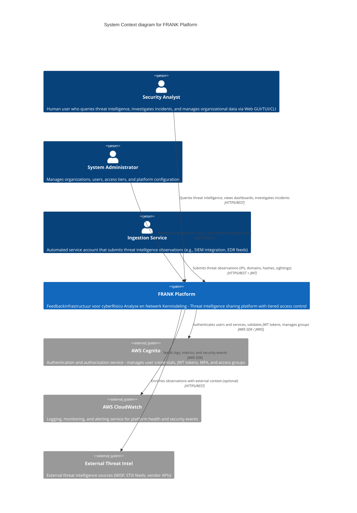

# FRANK System Context (C4 Level 1)

**Diagram Type**: C4 Context
**Last Updated**: 2026-02-06
**Related ADRs**: [ADR-0001](../../adr/0001-four-stage-infrastructure-evolution.md), [ADR-0005](../../adr/0005-cognito-authentication.md)

## Purpose

This diagram shows FRANK's system context: the big picture of how FRANK fits in its environment, who uses it, and what external systems it depends on. This is the starting point for understanding FRANK's architecture.

## Context Diagram

## Key Elements

### People (Actors)

| Actor | Role | Access Method | Access Tier |
|-------|------|---------------|-------------|
| **Security Analyst** | Primary user investigating threats and querying intelligence | Web GUI, TUI, CLI | OBSERVER, CONTRIBUTOR, PARTNER, CORE_MEMBER |
| **System Administrator** | Manages platform configuration, organizations, and users | Web GUI, TUI | CORE_MEMBER |
| **Ingestion Service** | Automated submission of threat observations | REST API + JWT | CONTRIBUTOR, PARTNER |

### FRANK Platform (Focus System)

**FRANK** is the central threat intelligence sharing platform that:
- Receives threat intelligence submissions (observables, sightings, campaigns)
- Stores and indexes threat data with tiered access control
- Provides query APIs for threat intelligence retrieval
- Enforces reciprocity model (contribution quality determines access level)
- Manages organizations, members, and access tiers

**Key Capabilities**:
- **Submission**: Ingest threat observables (IPs, domains, hashes, processes)
- **Query**: Search and filter threat intelligence with access tier filtering
- **Statistics**: Aggregate threat data for trend analysis
- **Access Control**: Five-tier access model (PUBLIC → OBSERVER → CONTRIBUTOR → PARTNER → CORE_MEMBER)
- **Reciprocity**: Track contribution quality to determine access privileges

### External Systems

| System | Purpose | Protocol | Managed By |
|--------|---------|----------|------------|
| **AWS Cognito** | Authentication and authorization backend | AWS SDK, JWKS | AWS |
| **AWS CloudWatch** | Logging, monitoring, metrics, alerts | AWS SDK | AWS |
| **External Threat Intel** | MISP, STIX feeds, vendor APIs (optional) | HTTPS/REST | Third parties |

#### AWS Cognito Details

- **User Pool**: Stores human user credentials and service account credentials
- **Groups**: Maps FRANK access tiers (FRANK_OBSERVER, FRANK_CONTRIBUTOR, etc.)
- **JWT Tokens**: Stateless authentication for all API calls
- **JWKS Endpoint**: Public key endpoint for token validation
- **MFA**: Multi-factor authentication for human users
- **Service Accounts**: Cognito users with `service-` prefix (e.g., `service-rabobank-ingestion`)

See [ADR-0005: AWS Cognito Authentication](../../adr/0005-cognito-authentication.md) for rationale.

#### AWS CloudWatch Details

- **Application Logs**: FastAPI request/response logs, error traces
- **Security Events**: Authentication failures, authorization denials, suspicious activity
- **Metrics**: Request rates, latency, database performance
- **Alarms**: Alert on error rates, latency thresholds, capacity limits

#### External Threat Intelligence (Optional)

- **MISP**: Malware Information Sharing Platform
- **STIX/TAXII**: Structured threat information feeds
- **Vendor APIs**: Commercial threat intelligence providers
- **Use Case**: Enrich submitted observables with external context (not required for core operation)

## Scope and Boundaries

### In Scope (FRANK Platform)
- ✅ Threat intelligence submission and storage
- ✅ Query APIs with tiered access control
- ✅ Organization and user management
- ✅ Access tier enforcement (reciprocity model)
- ✅ Statistics and aggregation
- ✅ Authentication proxy to Cognito

### Out of Scope (External Dependencies)
- ❌ User credential storage (delegated to Cognito)
- ❌ Token generation and refresh (delegated to Cognito)
- ❌ Infrastructure monitoring (delegated to CloudWatch)
- ❌ External threat intelligence generation (consumed, not produced)

## User Journeys

### Journey 1: Security Analyst Investigates Threat

1. Analyst logs in via **Web GUI** → FRANK → **Cognito** (authentication)
2. Receives **JWT token** (contains access tier from Cognito groups)
3. Queries FRANK for domain: `evil.com` → FRANK filters results by analyst's access tier
4. Views sightings, campaigns, and related observables
5. Exports data for further analysis

### Journey 2: Service Account Submits Threat Intelligence

1. Ingestion script authenticates with `service-org-ingestion` credentials → FRANK → **Cognito**
2. Receives **JWT token** (CONTRIBUTOR or PARTNER tier)
3. Submits batch of observables (IPs, domains, hashes) → FRANK → DynamoDB (see Container diagrams)
4. FRANK validates, deduplicates, and stores with submitter metadata
5. Access level determines visibility to other organizations (per ADR-0003)

### Journey 3: Administrator Manages Organizations

1. Admin logs in via **Web GUI** → FRANK → **Cognito** (CORE_MEMBER tier)
2. Navigates to organization management
3. Creates new organization, adds members, assigns roles
4. Configures access tier and reciprocity settings
5. Changes stored in **PostgreSQL** (see Container diagrams)

## Related Documentation

### Next Steps (Dive Deeper)
- **[Container Diagrams](02-container-stage1.md)** - See how FRANK is deployed across four stages
- **[Component Diagrams](03-component-sightings.md)** - Explore internal structure of APIs

### Cross-References
- **[ADR-0001: Four-Stage Infrastructure Evolution](../../adr/0001-four-stage-infrastructure-evolution.md)** - Architecture evolution strategy
- **[ADR-0003: Tiered Access Control Model](../../adr/0003-tiered-access-control-model.md)** - Five-tier access model
- **[ADR-0005: AWS Cognito Authentication](../../adr/0005-cognito-authentication.md)** - Authentication strategy
- **[HLD Functional](../../hld_functional.md)** - Business context and vision
- **[HLD Technical](../../highlevel_design.md)** - Detailed textual architecture

### Specifications
- **[Specs](../../../specs/README.md)** - Formal specifications for FRANK components
- **[Core Models](../../../specs/core/)** - Observable, Submission, Sighting data models
- **[APIs](../../../specs/apis/)** - Sightings API and Management API specifications

## Evolutionary Notes

This Context diagram is **stage-agnostic** - it represents FRANK's external interactions regardless of infrastructure stage. The internal implementation varies by stage:

- **Stage 1**: SQLite database, local development
- **Stage 2**: DynamoDB + MySQL, Docker containers
- **Stage 3**: AWS ECS, managed services
- **Stage 4**: Kubernetes, cloud-agnostic

See [Container diagrams](02-container-stage1.md) for stage-specific architecture.

---

*Part of FRANK's C4 architecture documentation*
*See [C4 README](README.md) for navigation and [ADR-0013](../../adr/0013-c4-model-architecture-visualization.md) for C4 adoption decision*
