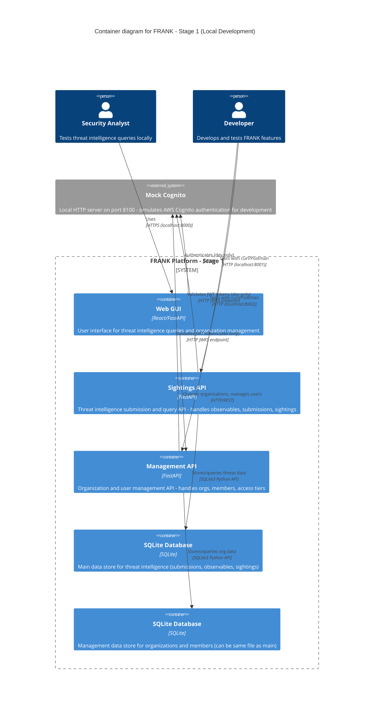

# FRANK Stage 1 Container Diagram (C4 Level 2)

**Diagram Type**: C4 Container
**Stage**: Stage 1 - Local Development (SQLite + FastAPI)
**Last Updated**: 2026-02-06
**Related ADRs**: [ADR-0001](../../adr/0001-four-stage-infrastructure-evolution.md), [ADR-0002](../../adr/0002-repository-pattern-database-abstraction.md), [ADR-0010](../../adr/0010-stages-vs-environments.md)

## Purpose

Stage 1 is FRANK's **foundation and development baseline**. It runs entirely on a developer's laptop with minimal dependencies, providing a working system for rapid iteration, testing, and proof-of-concept validation.

**Key Principle**: Stage 1 must always work. All higher stages build on this foundation.

## Container Diagram



## Container Descriptions

### Web GUI
- **Technology**: React frontend + FastAPI backend
- **Port**: 8000 (default)
- **Purpose**: User-facing interface for threat intelligence queries, dashboards, and organization management
- **Responsibilities**:
  - Render UI for analysts and admins
  - Proxy requests to Management API
  - Display threat intelligence query results
  - Provide forms for data submission and organization management
- **Data Flow**: Web GUI → Management API → SQLite (no direct database access)

### Sightings API (Threat Intelligence API)
- **Technology**: FastAPI (Python 3.11+)
- **Port**: 8001 (default)
- **Purpose**: High-volume threat intelligence data operations
- **Endpoints**:
  - `POST /v1/submissions` - Submit threat intelligence
  - `GET /v1/submissions/{id}` - Retrieve submission
  - `GET /v1/observables` - Query observables with filters
  - `GET /v1/statistics` - Aggregate threat data
  - `GET /v1/health` - Health check
- **Database**: SQLite via `SQLiteFRANKDatabase` implementation
- **Authentication**: Mock Cognito JWT validation (in Stage 1)
- **Access Control**: Five-tier filtering per [ADR-0003](../../adr/0003-tiered-access-control-model.md)

### Management API (Organization & User API)
- **Technology**: FastAPI (Python 3.11+)
- **Port**: 8002 (default)
- **Purpose**: Organization, user, and access tier management
- **Endpoints**:
  - `POST /v1/login` - Authenticate user (proxy to Cognito)
  - `POST /v1/logout` - Sign out user (proxy to Cognito)
  - `GET /v1/organizations` - List organizations
  - `POST /v1/organizations` - Create organization
  - `GET /v1/members` - List members
  - `POST /v1/members` - Add member to organization
- **Database**: SQLite via `SQLiteFRANKDatabase` (can share file with Sightings API)
- **Authentication**: Proxies to Mock Cognito in Stage 1
- **Access Control**: Role-based (admin vs. regular user)

### SQLite Database (Main)
- **Technology**: SQLite 3
- **File**: `frank_main.db` (configurable)
- **Purpose**: Persistent storage for threat intelligence data
- **Tables**:
  - `submissions` - Threat intelligence submissions
  - `observables` - IPs, domains, hashes, processes
  - `sightings` - Observation details
  - `target_organisations` - Affected organizations
  - `submitters` - Submitting organizations
- **Schema**: Designed to support all FRANK stages (same schema works in DynamoDB Stage 3)
- **Implementation**: `src/frank/storage/sqlite.py` - SQLiteFRANKDatabase class

### SQLite Database (Management)
- **Technology**: SQLite 3
- **File**: `frank_mgmt.db` or shared with main (configurable)
- **Purpose**: Persistent storage for organization and user data
- **Tables**:
  - `organisations` - Organization records
  - `organisation_members` - Member associations
- **Note**: In Stage 1, can use same SQLite file as main database for simplicity

### Mock Cognito (Development Only)
- **Technology**: Custom HTTP server (Python)
- **Port**: 8100 (default)
- **Purpose**: Simulate AWS Cognito authentication locally
- **Endpoints**:
  - `POST /login` - Return mock JWT token
  - `GET /.well-known/jwks.json` - Public key for JWT validation
  - `POST /refresh` - Refresh mock token
  - `POST /logout` - Simulate logout
- **Note**: **Stage 1 ONLY** - replaced by real AWS Cognito in Stage 3
- **Implementation**: See `tests/spikes/010_cognito/` for spike validation

## Deployment

### Running Stage 1 Locally

```bash
# Setup virtual environment
make dev
source .venv/bin/activate

# Run Stage 1 (SQLite + FastAPI)
cd environments/local-python
cp .env.stage1.example .env
./run-stage1.sh

# Or using local-docker
cd environments/local-docker
make stage1
```

### Environment Variables (Stage 1)

```bash
# Database
FRANK_DATABASE_TYPE=sqlite
FRANK_SQLITE_PATH=./frank_stage1.db

# APIs
SIGHTINGS_API_PORT=8001
MANAGEMENT_API_PORT=8002
WEB_GUI_PORT=8000

# Mock Cognito (dev only)
COGNITO_URL=http://localhost:8100
COGNITO_USER_POOL_ID=local-dev-pool
COGNITO_CLIENT_ID=local-dev-client
```

See `environments/local-python/.env.stage1.example` for complete configuration.

## Data Flow Examples

### Example 1: Submit Threat Intelligence

```
1. Developer sends POST to http://localhost:8001/v1/submissions
   Body: {
     "observables": [{"type": "ipv4", "value": "192.0.2.1"}],
     "severity": "high",
     "confidence": 85
   }
   Headers: Authorization: Bearer <mock-jwt>

2. Sightings API validates JWT via Mock Cognito JWKS endpoint

3. Sightings API calls SQLiteFRANKDatabase.store_submission()

4. SQLite writes to frank_main.db:
   - INSERT into submissions (id, severity, confidence, ...)
   - INSERT into observables (id, type, value, submission_id, ...)

5. Sightings API returns:
   {
     "submission_id": "submission--uuid",
     "status": "accepted",
     "observables_count": 1
   }
```

### Example 2: Query Observables

```
1. Analyst uses Web GUI to search for IP: 192.0.2.1

2. Web GUI → Management API → Validates JWT → Gets user's access tier

3. Web GUI → Sightings API: GET /v1/observables?ip=192.0.2.1
   Headers: Authorization: Bearer <mock-jwt>

4. Sightings API:
   - Validates JWT (Mock Cognito)
   - Extracts access tier from JWT claims
   - Calls SQLiteFRANKDatabase.query_observables(filters={"ip": "192.0.2.1"})
   - Applies access tier filtering per ADR-0003

5. SQLite: SELECT * FROM observables WHERE value = '192.0.2.1' AND ...

6. Sightings API filters results by access tier:
   - PUBLIC: Statistical summaries only
   - OBSERVER: Masked observables
   - CONTRIBUTOR: Partial observables
   - PARTNER: Full observables
   - CORE_MEMBER: Everything + attribution

7. Returns filtered results to Web GUI
```

## Stage 1 Characteristics

### Strengths
- ✅ **Simple**: Single-process architecture, no external dependencies
- ✅ **Fast iteration**: Changes visible immediately (FastAPI hot reload)
- ✅ **Portable**: Runs on any laptop with Python 3.11+
- ✅ **Testable**: Unit and integration tests run against SQLite
- ✅ **Deterministic**: Same code, same data, same results
- ✅ **Baseline**: All higher stages must maintain Stage 1 functionality

### Limitations
- ❌ **Single-user**: No concurrent access (SQLite file locking)
- ❌ **No scale**: Limited to laptop memory and disk
- ❌ **No production auth**: Mock Cognito not secure
- ❌ **Local only**: No remote access or cloud integration
- ❌ **Single-process**: No horizontal scaling

### Use Cases
- **Development**: Rapid feature iteration and testing
- **Testing**: Unit tests, integration tests, spike validation
- **Demos**: Proof-of-concept demonstrations
- **Onboarding**: New developer setup and learning
- **Debugging**: Isolated environment for troubleshooting

## Evolution Path

Stage 1 establishes patterns that persist through all stages:

| Concept | Stage 1 | Stage 2 | Stage 3 | Stage 4 |
|---------|---------|---------|---------|---------|
| **Core Logic** | ✅ `src/frank/core/` | Same code | Same code | Same code |
| **API Framework** | FastAPI | FastAPI | FastAPI | FastAPI/Go |
| **Database Interface** | BaseFRANKDatabase | Same interface | Same interface | Same interface |
| **Authentication** | Mock Cognito | Mock Cognito | AWS Cognito | Cognito/OAuth2 |
| **Deployment** | Python process | Docker Compose | AWS ECS | Kubernetes |

**Key Insight**: Business logic (`src/frank/core/`) is stage-agnostic. Only infrastructure adapters change.

## Related Documentation

### Next Stages
- **[Stage 2 Container Diagram](02-container-stage2.md)** - LocalStack + DynamoDB (learning cloud patterns)
- **[Stage 3 Container Diagram](02-container-stage3.md)** - AWS ECS + Managed Services (production cloud)
- **[Stage 4 Container Diagram](02-container-stage4.md)** - Kubernetes + ScyllaDB (cloud-agnostic scale)

### Component Details
- **[Sightings API Components](03-component-sightings.md)** - Internal structure of threat intelligence API
- **[Management API Components](03-component-management.md)** - Internal structure of organization API
- **[Storage Abstraction](03-component-storage.md)** - Database layer implementation

### ADRs
- **[ADR-0001: Four-Stage Infrastructure Evolution](../../adr/0001-four-stage-infrastructure-evolution.md)** - Why staged approach?
- **[ADR-0002: Repository Pattern](../../adr/0002-repository-pattern-database-abstraction.md)** - Database abstraction design
- **[ADR-0010: Stages vs Environments](../../adr/0010-stages-vs-environments.md)** - Infrastructure complexity vs deployment target

### Specifications
- **[SQLite Storage Spec](../../../specs/storage/sqlite.spec.md)** - SQLiteFRANKDatabase implementation requirements
- **[Sightings API Spec](../../../specs/core/sighting.spec.md)** - API behavioral specification

### Setup Instructions
- **[Local Python Environment](../../../environments/local-python/README.md)** - Running Stage 1 natively
- **[Local Docker Environment](../../../environments/local-docker/README.md)** - Running Stage 1 in containers

---

*Part of FRANK's C4 architecture documentation*
*See [C4 README](README.md) for navigation and [Context Diagram](01-context.md) for system overview*
