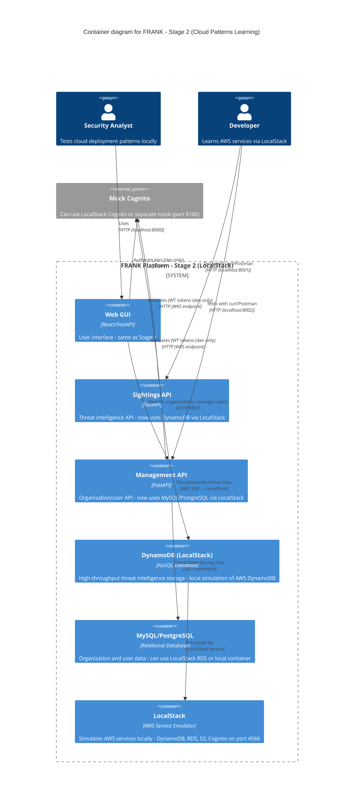

# FRANK Stage 2 Container Diagram (C4 Level 2)

**Diagram Type**: C4 Container
**Stage**: Stage 2 - Cloud Patterns Learning (LocalStack + DynamoDB/MySQL)
**Last Updated**: 2026-02-06
**Related ADRs**: [ADR-0001](../../adr/0001-four-stage-infrastructure-evolution.md), [ADR-0002](../../adr/0002-repository-pattern-database-abstraction.md), [ADR-0009](../../adr/0009-postgresql-management-api.md)

## Purpose

Stage 2 is FRANK's **cloud patterns learning stage**. It introduces AWS services (DynamoDB, RDS) using LocalStack for local simulation, teaching cloud-native patterns without AWS costs while maintaining the same codebase from Stage 1.

**Key Principle**: Learn cloud infrastructure patterns locally before deploying to real AWS (Stage 3).

## Container Diagram



## Container Descriptions

### Web GUI
- **Technology**: React frontend + FastAPI backend
- **Port**: 8000 (default)
- **Changes from Stage 1**: None - same code, different backend databases
- **Purpose**: User-facing interface (unchanged from Stage 1)

### Sightings API (Threat Intelligence API)
- **Technology**: FastAPI (Python 3.11+)
- **Port**: 8001 (default)
- **Database**: **DynamoDB** via `DynamoDBFRANKDatabase` implementation
- **New in Stage 2**:
  - Uses AWS SDK (boto3) to connect to LocalStack DynamoDB
  - Same endpoints as Stage 1, different storage backend
  - Tests NoSQL access patterns (single-table design)
  - Learns DynamoDB query/scan operations
- **Endpoints**: Same as Stage 1 (`/v1/submissions`, `/v1/observables`, etc.)
- **Implementation**: `src/frank/storage/dynamodb.py` - DynamoDBFRANKDatabase class

### Management API (Organization & User API)
- **Technology**: FastAPI (Python 3.11+)
- **Port**: 8002 (default)
- **Database**: **MySQL** or **PostgreSQL** (via LocalStack RDS or local container)
- **New in Stage 2**:
  - Uses relational database for structured organization data
  - Connection pooling and transaction management
  - SQL migrations and schema management
  - Tests RDS patterns before AWS deployment
- **Endpoints**: Same as Stage 1 (organization, member CRUD)
- **Implementation**: `src/frank/storage/postgresql.py` - PostgreSQLFRANKDatabase class

### DynamoDB (LocalStack)
- **Technology**: LocalStack simulation of AWS DynamoDB
- **Endpoint**: `http://localhost:4566`
- **Purpose**: Local simulation of AWS DynamoDB for threat intelligence storage
- **Tables**:
  - `frank-submissions` - Main table with single-table design
  - Partition Key: `pk` (entity type prefix, e.g., `SUB#uuid`)
  - Sort Key: `sk` (relationship or timestamp)
- **Access Patterns**:
  - Get submission by ID: `pk=SUB#id, sk=METADATA`
  - Query observables: GSI on observable type/value
  - Query by organization: GSI on submitter org_id
  - Statistics: GSI on severity + timestamp
- **Stage 2 Learning Goals**:
  - Single-table design patterns
  - GSI (Global Secondary Index) usage
  - Query vs. Scan optimization
  - DynamoDB Streams (optional)

### MySQL/PostgreSQL (Local or LocalStack RDS)
- **Technology**: MySQL 8 or PostgreSQL 14+
- **Endpoint**: `localhost:3306` (MySQL) or `localhost:5432` (PostgreSQL)
- **Purpose**: Relational storage for organization and user data
- **Tables**:
  - `organisations` - Organization records with metadata
  - `organisation_members` - Many-to-many relationship table
- **Schema**: Same as Stage 1 SQLite, now with relational DB features:
  - Foreign key constraints
  - Transactions
  - Connection pooling
  - Migrations (Alembic)

### LocalStack
- **Technology**: LocalStack Community or Pro
- **Port**: 4566 (all services)
- **Purpose**: Local AWS cloud stack simulator
- **Services Used in Stage 2**:
  - **DynamoDB** - NoSQL database simulation
  - **RDS** - Relational database (optional, can use local MySQL/PostgreSQL)
  - **S3** - Object storage (optional, for exports/backups)
  - **Cognito** - Authentication (optional, can use separate mock)
  - **CloudWatch** - Logging (optional, for observability practice)
- **Persistence**: Can persist data between restarts using volume mounts
- **Configuration**: `docker-compose.yml` in `environments/local-docker/`

### Mock Cognito
- **Technology**: LocalStack Cognito or separate mock HTTP server
- **Port**: 8100 (if separate) or 4566 (if LocalStack)
- **Purpose**: Simulate AWS Cognito authentication locally
- **Stage 2 Note**: Can practice Cognito integration patterns for Stage 3

## Deployment

### Running Stage 2 Locally

**Option 1: Docker Compose (Recommended)**
```bash
cd environments/local-docker
make stage2
# Or: docker-compose -f docker-compose.stage2.yml up
```

**Option 2: LocalStack + Native Python**
```bash
# Terminal 1: Start LocalStack
docker run --rm -it -p 4566:4566 localstack/localstack

# Terminal 2: Run FRANK APIs
cd environments/local-python
cp .env.stage2.example .env
source .venv/bin/activate
./run-stage2.sh
```

### Environment Variables (Stage 2)

```bash
# Database - Sightings API
FRANK_DATABASE_TYPE=dynamodb
AWS_ENDPOINT_URL=http://localhost:4566  # LocalStack
DYNAMODB_TABLE_NAME=frank-submissions
AWS_REGION=us-east-1
AWS_ACCESS_KEY_ID=test  # LocalStack dummy credentials
AWS_SECRET_ACCESS_KEY=test

# Database - Management API
MANAGEMENT_DATABASE_TYPE=postgresql
POSTGRESQL_HOST=localhost
POSTGRESQL_PORT=5432
POSTGRESQL_DATABASE=frank_mgmt
POSTGRESQL_USER=frank
POSTGRESQL_PASSWORD=frank_local_dev

# APIs
SIGHTINGS_API_PORT=8001
MANAGEMENT_API_PORT=8002
WEB_GUI_PORT=8000

# Mock Cognito (or LocalStack Cognito)
COGNITO_URL=http://localhost:4566  # LocalStack
COGNITO_USER_POOL_ID=us-east-1_localpool
COGNITO_CLIENT_ID=local-client-id
```

See `environments/local-docker/docker-compose.stage2.yml` for complete configuration.

## Data Flow Examples

### Example 1: Submit Threat Intelligence (DynamoDB)

```
1. Developer sends POST to http://localhost:8001/v1/submissions
   Body: {
     "observables": [{"type": "ipv4", "value": "203.0.113.42"}],
     "severity": "critical",
     "confidence": 90
   }
   Headers: Authorization: Bearer <mock-jwt>

2. Sightings API validates JWT via Mock Cognito

3. Sightings API calls DynamoDBFRANKDatabase.store_submission()

4. DynamoDB (via LocalStack) writes to frank-submissions table:
   Items:
   - pk="SUB#uuid", sk="METADATA", data={submission fields}
   - pk="SUB#uuid", sk="OBS#0", data={observable data}
   - pk="IP#203.0.113.42", sk="SUB#uuid", data={reverse lookup}

5. Sightings API returns:
   {
     "submission_id": "submission--uuid",
     "status": "accepted",
     "observables_count": 1
   }
```

### Example 2: Query Organizations (PostgreSQL)

```
1. Admin uses Web GUI to list organizations

2. Web GUI → Management API: GET /v1/organizations
   Headers: Authorization: Bearer <mock-jwt>

3. Management API:
   - Validates JWT (Mock Cognito)
   - Checks admin role from JWT claims
   - Calls PostgreSQLFRANKDatabase.list_organisations()

4. PostgreSQL: SELECT * FROM organisations ORDER BY created_at DESC

5. Management API returns:
   [
     {"org_id": "...", "name": "Rabobank", "tier": "PARTNER"},
     {"org_id": "...", "name": "ING", "tier": "CONTRIBUTOR"}
   ]

6. Web GUI displays organization list
```

## Stage 2 Characteristics

### Strengths
- ✅ **Cloud patterns**: Learn AWS services without costs
- ✅ **Same codebase**: Business logic unchanged from Stage 1
- ✅ **Dual database**: Experience both NoSQL (DynamoDB) and SQL (PostgreSQL)
- ✅ **Container deployment**: Practice Docker Compose orchestration
- ✅ **AWS SDK**: Learn boto3 patterns for Stage 3
- ✅ **Local development**: Fast iteration, no internet required
- ✅ **Persistence**: LocalStack can persist data between restarts

### Limitations
- ❌ **Not production-ready**: LocalStack has behavioral differences from real AWS
- ❌ **Limited scale**: Still local laptop constraints
- ❌ **Feature gaps**: LocalStack doesn't perfectly match AWS
- ❌ **No real IAM**: Limited IAM policy testing
- ❌ **Single-host**: Can't test distributed patterns

### Use Cases
- **Learning**: Understand AWS services before Stage 3 deployment
- **Testing**: Validate DynamoDB access patterns locally
- **Development**: Develop Stage 3 features in Stage 2 first
- **CI/CD**: Run integration tests against LocalStack
- **Cost reduction**: Avoid AWS charges during development

### What Stage 2 Teaches

| Concept | Learning Outcome | Applies to Stage 3 |
|---------|------------------|-------------------|
| **DynamoDB** | Single-table design, GSI queries | ✅ Direct transfer |
| **AWS SDK (boto3)** | Client initialization, error handling | ✅ Same code |
| **Connection pooling** | PostgreSQL pool management | ✅ RDS patterns |
| **Docker Compose** | Multi-container orchestration | ✅ Deployment understanding |
| **Environment config** | AWS credentials, endpoints | ✅ Production config |
| **NoSQL access patterns** | Query design, denormalization | ✅ DynamoDB optimization |

## Evolution Path

### From Stage 1 → Stage 2

**Code Changes**:
- ✅ Business logic (`src/frank/core/`) - **NO CHANGES**
- ✅ Storage interface (`BaseFRANKDatabase`) - **NO CHANGES**
- ✅ New implementations:
  - `src/frank/storage/dynamodb.py` - DynamoDBFRANKDatabase
  - `src/frank/storage/postgresql.py` - PostgreSQLFRANKDatabase
- ✅ Configuration changes:
  - Environment variables for AWS endpoints
  - Docker Compose files for LocalStack

**Database Schema**:
- SQLite → DynamoDB: Single-table design with pk/sk pattern
- SQLite → PostgreSQL: Same schema, add foreign keys and indexes

### From Stage 2 → Stage 3

**Code Changes**:
- ✅ Business logic - **NO CHANGES**
- ✅ Storage implementations - **NO CHANGES**
- ✅ Configuration changes:
  - AWS endpoint: LocalStack → Real AWS
  - AWS credentials: Dummy → Real IAM roles
  - Cognito: Mock → Real Cognito User Pool

**Infrastructure Changes**:
- LocalStack → AWS Cloud (ECS, DynamoDB, RDS)
- Docker Compose → CloudFormation/Terraform
- Local ports → Application Load Balancer
- No authentication → AWS Cognito with MFA

## Related Documentation

### Previous and Next Stages
- **[Stage 1 Container Diagram](02-container-stage1.md)** - SQLite baseline (simplified from Stage 2)
- **[Stage 3 Container Diagram](02-container-stage3.md)** - AWS Cloud deployment (Stage 2 patterns in production)
- **[Stage 4 Container Diagram](02-container-stage4.md)** - Kubernetes + ScyllaDB (cloud-agnostic scale)

### Component Details
- **[Sightings API Components](03-component-sightings.md)** - Internal structure (same across stages)
- **[Management API Components](03-component-management.md)** - Internal structure (same across stages)
- **[Storage Abstraction](03-component-storage.md)** - DynamoDB and PostgreSQL implementations

### ADRs
- **[ADR-0001: Four-Stage Infrastructure Evolution](../../adr/0001-four-stage-infrastructure-evolution.md)** - Stage 2 rationale
- **[ADR-0002: Repository Pattern](../../adr/0002-repository-pattern-database-abstraction.md)** - Why same code works across stages
- **[ADR-0009: PostgreSQL for Management API](../../adr/0009-postgresql-management-api.md)** - Management API database choice

### Specifications
- **[DynamoDB Storage Spec](../../../specs/storage/dynamodb.spec.md)** - DynamoDBFRANKDatabase requirements
- **[PostgreSQL Storage Spec](../../../specs/storage/postgresql.spec.md)** - PostgreSQLFRANKDatabase requirements

### Setup Instructions
- **[Local Docker Environment](../../../environments/local-docker/README.md)** - Running Stage 2 with Docker Compose
- **[LocalStack Documentation](https://docs.localstack.cloud/)** - LocalStack service emulator

## Testing in Stage 2

### Integration Tests with LocalStack

```bash
# Start LocalStack
docker-compose -f docker-compose.stage2.yml up -d

# Run integration tests
pytest tests/integration/ --stage=stage2

# Or use behave for BDD tests
behave tests/integration/features/ --stage=stage2
```

### Validating AWS Patterns

Stage 2 lets you validate:
- ✅ DynamoDB table design and access patterns
- ✅ GSI query performance (simulated)
- ✅ PostgreSQL migrations and schema
- ✅ AWS SDK error handling
- ✅ Multi-container orchestration
- ✅ Environment configuration management

---

*Part of FRANK's C4 architecture documentation*
*See [C4 README](README.md) for navigation and [Context Diagram](01-context.md) for system overview*
