# FRANK Stage 3 Container Diagram (C4 Level 2)

**Diagram Type**: C4 Container
**Stage**: Stage 3 - AWS Cloud Production Deployment (ECS + Managed Services)
**Last Updated**: 2026-02-06
**Related ADRs**: [ADR-0001](../../adr/0001-four-stage-infrastructure-evolution.md), [ADR-0005](../../adr/0005-cognito-authentication.md), [ADR-0009](../../adr/0009-postgresql-management-api.md)

## Purpose

Stage 3 is FRANK's **production cloud deployment**. It deploys the same codebase from Stages 1-2 to AWS Cloud using managed services (ECS Fargate, DynamoDB, RDS, Cognito), achieving cloud-native scalability, reliability, and security.

**Key Principle**: Same business logic as Stage 1, production infrastructure with auto-scaling and managed services.

## Container Diagram

```mermaid
C4Container
    title Container diagram for FRANK - Stage 3 (AWS Cloud Production)

    Person(analyst, "Security Analyst", "Accesses FRANK via internet (HTTPS)")
    Person(admin, "System Administrator", "Manages platform via secure web interface")
    Person(service, "Ingestion Service", "Submits threat intel from external systems")

    System_Boundary(aws_cloud, "AWS Cloud - Production Environment") {
        System_Boundary(vpc, "VPC (Multi-AZ)") {
            System_Boundary(public_subnet, "Public Subnets") {
                Container(alb, "Application Load Balancer", "AWS ALB", "HTTPS termination, request routing, health checks - routes to ECS tasks")
            }

            System_Boundary(private_subnet, "Private Subnets") {
                Container(ecs_webapp, "Web GUI Task", "ECS Fargate", "React/FastAPI in container - 2-10 tasks with auto-scaling")
                Container(ecs_sightings, "Sightings API Task", "ECS Fargate", "FastAPI threat intelligence API - 2-10 tasks with auto-scaling")
                Container(ecs_mgmt, "Management API Task", "ECS Fargate", "FastAPI organization API - 2-10 tasks with auto-scaling")
            }
        }

        Container(dynamodb, "DynamoDB", "AWS DynamoDB", "Managed NoSQL database for high-throughput threat intelligence - on-demand capacity")
        Container(rds, "RDS PostgreSQL", "AWS RDS", "Managed relational database for organizations/members - Multi-AZ with automated backups")
        Container(cognito, "AWS Cognito", "Cognito User Pool", "Managed authentication - user credentials, JWT tokens, MFA, groups")
        Container(ecr, "ECR", "Elastic Container Registry", "Docker image repository for FRANK containers")
        Container(cloudwatch, "CloudWatch", "AWS CloudWatch", "Centralized logging, metrics, alarms - application and infrastructure monitoring")
        Container(secrets, "Secrets Manager", "AWS Secrets Manager", "Secure storage for database credentials, API keys, certificates")
    }

    Rel(analyst, alb, "HTTPS requests", "HTTPS (TLS 1.2+)")
    Rel(admin, alb, "HTTPS requests", "HTTPS (TLS 1.2+)")
    Rel(service, alb, "Submit threat data", "HTTPS + JWT")

    Rel(alb, ecs_webapp, "Routes /app/* requests", "HTTP (internal)")
    Rel(alb, ecs_sightings, "Routes /v1/submissions, /v1/observables", "HTTP (internal)")
    Rel(alb, ecs_mgmt, "Routes /v1/organizations, /v1/members", "HTTP (internal)")

    Rel(ecs_webapp, ecs_mgmt, "Queries organizations, manages users", "HTTP (internal VPC)")
    Rel(ecs_webapp, cognito, "Authenticates users", "AWS SDK")

    Rel(ecs_sightings, dynamodb, "Stores/queries threat data", "AWS SDK")
    Rel(ecs_mgmt, rds, "Stores/queries org data", "PostgreSQL connection")

    Rel(ecs_sightings, cognito, "Validates JWT tokens", "JWKS endpoint")
    Rel(ecs_mgmt, cognito, "Authenticates, manages users", "AWS SDK + JWKS")

    Rel(ecs_webapp, cloudwatch, "Sends logs and metrics", "CloudWatch Logs Agent")
    Rel(ecs_sightings, cloudwatch, "Sends logs and metrics", "CloudWatch Logs Agent")
    Rel(ecs_mgmt, cloudwatch, "Sends logs and metrics", "CloudWatch Logs Agent")

    Rel(ecs_mgmt, secrets, "Retrieves database credentials", "AWS SDK")
    Rel(ecs_sightings, secrets, "Retrieves database credentials", "AWS SDK")

    UpdateLayoutConfig($c4ShapeInRow="3", $c4BoundaryInRow="1")
```



## Container Descriptions

### Application Load Balancer (ALB)
- **Technology**: AWS Application Load Balancer
- **Purpose**: HTTPS termination, request routing, health checks
- **Features**:
  - SSL/TLS certificate from ACM (AWS Certificate Manager)
  - Path-based routing:
    - `/app/*` → Web GUI
    - `/v1/submissions/*`, `/v1/observables/*` → Sightings API
    - `/v1/organizations/*`, `/v1/members/*` → Management API
  - Health checks: `GET /v1/health` on each API
  - Target groups for each ECS service
  - Access logs to S3 (compliance)
- **Security**:
  - Security group: Allow 443 from internet, 80 redirect to 443
  - WAF integration (optional, for DDoS protection)

### Web GUI Task (ECS Fargate)
- **Technology**: Docker container (React + FastAPI) on ECS Fargate
- **Scaling**: 2-10 tasks (auto-scaling based on CPU, memory, request rate)
- **Image**: Stored in ECR, tagged with git commit SHA
- **Configuration**:
  - CPU: 512 (0.5 vCPU)
  - Memory: 1024 MB
  - Port: 8000
- **Environment**: Environment variables from Systems Manager Parameter Store
- **Health Check**: `GET /health` endpoint
- **Same code as Stage 1/2**: No changes, different deployment

### Sightings API Task (ECS Fargate)
- **Technology**: Docker container (FastAPI) on ECS Fargate
- **Scaling**: 2-10 tasks (auto-scaling based on CPU 70%, memory 80%, request rate 1000/min per task)
- **Image**: Stored in ECR, tagged with git commit SHA
- **Configuration**:
  - CPU: 1024 (1 vCPU)
  - Memory: 2048 MB
  - Port: 8001
- **Database**: DynamoDB via AWS SDK (same code as Stage 2 LocalStack)
- **Authentication**: AWS Cognito JWKS endpoint for JWT validation
- **IAM Role**: Task execution role with DynamoDB read/write permissions
- **Endpoints**: Same as Stage 1/2 (`/v1/submissions`, `/v1/observables`, etc.)
- **Implementation**: `src/frank/storage/dynamodb.py` - **NO CHANGES** from Stage 2

### Management API Task (ECS Fargate)
- **Technology**: Docker container (FastAPI) on ECS Fargate
- **Scaling**: 2-10 tasks (auto-scaling based on CPU, memory)
- **Image**: Stored in ECR, tagged with git commit SHA
- **Configuration**:
  - CPU: 512 (0.5 vCPU)
  - Memory: 1024 MB
  - Port: 8002
- **Database**: RDS PostgreSQL (Multi-AZ)
- **Authentication**: Proxies to AWS Cognito for login, user management
- **IAM Role**: Task execution role with Cognito and Secrets Manager permissions
- **Connection Pooling**: PostgreSQL connection pool with 20 max connections
- **Implementation**: `src/frank/storage/postgresql.py` - **NO CHANGES** from Stage 2

### DynamoDB (AWS Managed)
- **Technology**: AWS DynamoDB with on-demand capacity
- **Table**: `frank-submissions-prod`
- **Capacity Mode**: On-demand (pay per request, auto-scaling)
- **Attributes**:
  - Partition Key: `pk` (string) - Entity type prefix
  - Sort Key: `sk` (string) - Relationship or timestamp
- **Global Secondary Indexes (GSI)**:
  - `ObservableTypeIndex` - Query by observable type (IP, domain, hash)
  - `OrganizationIndex` - Query by submitter organization
  - `SeverityIndex` - Query by severity + timestamp
- **Features**:
  - Point-in-time recovery (PITR) enabled
  - Encryption at rest (AWS managed KMS key)
  - DynamoDB Streams (optional, for audit logging)
  - Backup: Daily automated backups
- **Access Pattern**: Same single-table design as Stage 2

### RDS PostgreSQL (AWS Managed)
- **Technology**: AWS RDS PostgreSQL 14
- **Instance**: db.t3.medium (Multi-AZ for high availability)
- **Storage**: 100 GB gp3 (SSD) with auto-scaling to 500 GB
- **Tables**: `organisations`, `organisation_members`
- **Features**:
  - Multi-AZ deployment (automatic failover)
  - Automated backups (7-day retention)
  - Encryption at rest (AWS KMS)
  - Encryption in transit (SSL/TLS)
  - Performance Insights enabled
- **Security**:
  - Security group: Allow 5432 from ECS tasks only
  - Master password in Secrets Manager
  - No public access (private subnets only)

### AWS Cognito User Pool
- **Technology**: AWS Cognito with User Pool
- **Purpose**: Centralized authentication for humans and service accounts
- **Features**:
  - User registration and sign-in
  - JWT token generation (access + refresh)
  - MFA support (TOTP, SMS)
  - Groups for access tiers:
    - `FRANK_OBSERVER`
    - `FRANK_CONTRIBUTOR`
    - `FRANK_PARTNER`
    - `FRANK_CORE_MEMBER`
  - Service accounts: Users with `service-` prefix
  - Password policies: Min 12 chars, upper/lower/number/symbol
- **JWKS Endpoint**: Public key endpoint for stateless JWT validation
- **Token Expiration**:
  - Access token: 1 hour
  - Refresh token: 30 days
- **See**: [ADR-0005: AWS Cognito Authentication](../../adr/0005-cognito-authentication.md)

### ECR (Elastic Container Registry)
- **Technology**: AWS ECR private registry
- **Repositories**:
  - `frank-webapp`
  - `frank-sightings-api`
  - `frank-management-api`
- **Image Tagging**: Git commit SHA + `latest` tag
- **Lifecycle Policy**: Keep last 10 images, delete older
- **Scanning**: Automated vulnerability scanning on push
- **Permissions**: ECS tasks can pull images via IAM role

### CloudWatch Logs & Metrics
- **Technology**: AWS CloudWatch
- **Log Groups**:
  - `/ecs/frank-webapp`
  - `/ecs/frank-sightings-api`
  - `/ecs/frank-management-api`
- **Retention**: 30 days
- **Metrics**:
  - ECS task CPU/memory utilization
  - ALB request count, latency, error rate
  - DynamoDB consumed capacity, throttles
  - RDS connections, CPU, storage
- **Alarms**:
  - High error rate (> 5% of requests)
  - High latency (p95 > 1 second)
  - Task failures (> 2 restarts in 5 minutes)
  - Database connection exhaustion

### Secrets Manager
- **Technology**: AWS Secrets Manager
- **Secrets**:
  - `frank/prod/db/master-password` - RDS master password
  - `frank/prod/cognito/client-secret` - Cognito app client secret
  - `frank/prod/jwt/signing-key` - JWT signing key (if custom auth)
- **Rotation**: Automatic rotation every 90 days (for RDS)
- **Access**: ECS task IAM roles can read secrets

## Deployment Architecture

### VPC Design
- **CIDR**: 10.0.0.0/16
- **Availability Zones**: 3 AZs for high availability
- **Subnets**:
  - **Public Subnets** (3): 10.0.1.0/24, 10.0.2.0/24, 10.0.3.0/24
    - Internet Gateway attached
    - Route to 0.0.0.0/0 via IGW
    - Hosts: Application Load Balancer, NAT Gateways
  - **Private Subnets** (3): 10.0.11.0/24, 10.0.12.0/24, 10.0.13.0/24
    - No direct internet access
    - Route to 0.0.0.0/0 via NAT Gateway (for outbound only)
    - Hosts: ECS tasks, RDS instances

### Security Groups

**ALB Security Group**:
- Inbound: 443 from 0.0.0.0/0 (public internet)
- Inbound: 80 from 0.0.0.0/0 (redirect to 443)
- Outbound: All traffic

**ECS Task Security Group**:
- Inbound: 8000-8002 from ALB security group
- Outbound: 443 to DynamoDB VPC endpoint
- Outbound: 5432 to RDS security group
- Outbound: 443 to Cognito, Secrets Manager

**RDS Security Group**:
- Inbound: 5432 from ECS task security group
- Outbound: None (no egress needed)

### Auto-Scaling Configuration

**Sightings API (High Volume)**:
- Min: 2 tasks, Max: 10 tasks
- Target CPU: 70%
- Target Memory: 80%
- Custom Metric: Request rate > 1000 req/min per task → scale out
- Scale-out cooldown: 60 seconds
- Scale-in cooldown: 300 seconds (5 minutes)

**Management API (Low Volume)**:
- Min: 2 tasks, Max: 6 tasks
- Target CPU: 70%
- Target Memory: 80%

**Web GUI**:
- Min: 2 tasks, Max: 6 tasks
- Target CPU: 60%

## Data Flow Examples

### Example 1: User Login (Production)

```
1. Analyst enters credentials in Web GUI → HTTPS to ALB

2. ALB → Web GUI Task: POST /login
   Body: {"username": "analyst@org.nl", "password": "***"}

3. Web GUI → Management API: POST /v1/login (internal HTTP)

4. Management API → AWS Cognito: InitiateAuth API call
   SDK: boto3.client('cognito-idp').initiate_auth()

5. Cognito validates credentials:
   - Checks password hash
   - Verifies MFA if enabled
   - Generates JWT access token + refresh token

6. Cognito → Management API: Returns tokens

7. Management API → Web GUI: Returns tokens

8. Web GUI → Analyst: Sets secure HttpOnly cookies with tokens

9. Analyst is authenticated, subsequent requests include JWT in Authorization header
```

### Example 2: Submit Threat Intelligence (Production)

```
1. Service account authenticates (gets JWT from Cognito)

2. Service → ALB: POST /v1/submissions
   Headers: Authorization: Bearer <jwt>
   Body: {"observables": [...], "severity": "high"}

3. ALB → Sightings API Task (one of 2-10 running tasks)

4. Sightings API:
   - Extracts JWT from Authorization header
   - Validates JWT via Cognito JWKS endpoint (public key)
   - Checks expiration, signature, issuer
   - Extracts claims: user_id, org_id, access_tier (from Cognito group)

5. Sightings API → DynamoDB: PutItem operations
   - Write submission metadata
   - Write observable records
   - Write reverse lookup entries
   - Single-table design with pk/sk pattern

6. DynamoDB confirms writes

7. Sightings API → CloudWatch: Log successful submission

8. Sightings API → Service: 201 Created
   Body: {"submission_id": "...", "status": "accepted"}
```

### Example 3: Query Threat Intelligence (Production)

```
1. Analyst → Web GUI: Search for IP 198.51.100.42

2. Web GUI → ALB → Sightings API: GET /v1/observables?ip=198.51.100.42
   Headers: Authorization: Bearer <analyst-jwt>

3. Sightings API validates JWT (Cognito JWKS)

4. Sightings API extracts access_tier from JWT claims:
   - Analyst is in FRANK_PARTNER group → PARTNER tier

5. Sightings API → DynamoDB: Query ObservableTypeIndex
   - pk = "IP#198.51.100.42"
   - Retrieve all related submissions

6. Sightings API applies access tier filtering:
   - PARTNER tier → Show full observables, partial attribution

7. Sightings API → Web GUI: Filtered results

8. Web GUI displays threat intelligence to analyst
```

## Deployment Process

### Initial Deployment (Ansible)

```bash
cd environments/aws-prod/

# 1. Prerequisites: SSL certificate, ECR repositories
ansible-playbook ../../ansible/playbook.yml --tags ssl

# 2. Build and push Docker images to ECR
ansible-playbook ../../ansible/playbook.yml --tags docker

# 3. Create DynamoDB tables and RDS instance
ansible-playbook ../../ansible/playbook.yml --tags dynamodb,rds

# 4. Deploy CloudFormation stack (VPC, ECS, ALB, etc.)
ansible-playbook ../../ansible/playbook.yml --tags cloudformation

# 5. Deploy ECS services
ansible-playbook ../../ansible/playbook.yml --tags deploy
```

### CI/CD Pipeline (GitHub Actions)

```yaml
# Triggered on push to main branch
1. Run tests (pytest, ruff, mypy)
2. Build Docker images
3. Push images to ECR with git SHA tag
4. Update ECS task definitions
5. Deploy to ECS (rolling update, zero downtime)
6. Run smoke tests
7. Notify team (Slack, email)
```

### Health Checks (4 Levels)

1. **Docker Health Check**: `HEALTHCHECK CMD curl -f http://localhost:8001/v1/health`
2. **ECS Task Health Check**: Container must pass health check to be marked healthy
3. **ALB Target Group Health Check**: `GET /v1/health` every 30 seconds
4. **Deep Health Check**: `GET /v1/health/deep` - checks database connectivity

## Stage 3 Characteristics

### Strengths
- ✅ **Production-ready**: Managed services, high availability, auto-scaling
- ✅ **Scalable**: Handles 10,000+ requests/minute with auto-scaling
- ✅ **Secure**: Cognito authentication, VPC isolation, encryption at rest/transit
- ✅ **Observable**: CloudWatch logs, metrics, alarms for monitoring
- ✅ **Resilient**: Multi-AZ deployment, automated failover, health checks
- ✅ **Same codebase**: Business logic unchanged from Stage 1/2
- ✅ **Managed services**: No server management, automated backups, patching

### Limitations
- ❌ **AWS-specific**: Tightly coupled to AWS services
- ❌ **Cost**: Monthly AWS costs (hundreds to thousands of dollars)
- ❌ **Complexity**: More moving parts, harder to debug than Stage 1
- ❌ **Vendor lock-in**: DynamoDB, Cognito are AWS-only

### Production Considerations
- **Cost optimization**: Use Reserved Instances for predictable workloads
- **Monitoring**: Set up comprehensive CloudWatch dashboards
- **Disaster recovery**: Regular backups, tested restore procedures
- **Security**: Regular security audits, penetration testing
- **Compliance**: GDPR, SOC 2 compliance for threat intelligence handling

## Evolution Path

### From Stage 2 → Stage 3

**Code Changes**: **NONE** to business logic
- Same `src/frank/core/`
- Same `src/frank/storage/dynamodb.py`
- Same `src/frank/storage/postgresql.py`

**Configuration Changes**:
```diff
- AWS_ENDPOINT_URL=http://localhost:4566  # LocalStack
+ # No endpoint URL (use default AWS endpoints)

- AWS_ACCESS_KEY_ID=test
- AWS_SECRET_ACCESS_KEY=test
+ # Use IAM roles (no credentials in code)

- COGNITO_URL=http://localhost:4566
+ COGNITO_URL=https://cognito-idp.us-east-1.amazonaws.com
```

**Infrastructure**:
- LocalStack → Real AWS services
- Docker Compose → ECS Fargate + CloudFormation
- Local laptop → Multi-AZ VPC with auto-scaling

### From Stage 3 → Stage 4

- AWS ECS → Kubernetes (cloud-agnostic)
- DynamoDB → ScyllaDB (multi-cloud)
- AWS Cognito → OAuth2/OIDC provider (portable)
- See [Stage 4 Container Diagram](02-container-stage4.md)

## Related Documentation

### Previous and Next Stages
- **[Stage 1 Container Diagram](02-container-stage1.md)** - SQLite baseline
- **[Stage 2 Container Diagram](02-container-stage2.md)** - LocalStack learning
- **[Stage 4 Container Diagram](02-container-stage4.md)** - Kubernetes (future)

### Component Details
- **[Sightings API Components](03-component-sightings.md)** - Internal API structure
- **[Management API Components](03-component-management.md)** - Internal API structure
- **[Storage Abstraction](03-component-storage.md)** - Database implementations

### ADRs
- **[ADR-0001: Four-Stage Evolution](../../adr/0001-four-stage-infrastructure-evolution.md)**
- **[ADR-0005: AWS Cognito Authentication](../../adr/0005-cognito-authentication.md)**
- **[ADR-0009: PostgreSQL for Management API](../../adr/0009-postgresql-management-api.md)**

### Deployment Guides
- **[AWS Production Environment](../../../environments/aws-prod/README.md)**
- **[Ansible Playbooks](../../../ansible/README.md)**

---

*Part of FRANK's C4 architecture documentation*
*See [C4 README](README.md) for navigation and [Context Diagram](01-context.md) for system overview*
