# FRANK Stage 4 Container Diagram (C4 Level 2)

**Diagram Type**: C4 Container
**Stage**: Stage 4 - Cloud-Agnostic Production Scale (Kubernetes + ScyllaDB)
**Last Updated**: 2026-02-06
**Status**: **FUTURE STATE** (Not yet implemented)
**Related ADRs**: [ADR-0001](../../adr/0001-four-stage-infrastructure-evolution.md)

## Purpose

Stage 4 is FRANK's **cloud-agnostic production scale** stage. It transitions from AWS-specific services to portable technologies (Kubernetes, ScyllaDB, OAuth2), enabling multi-cloud deployment, massive scale, and avoiding vendor lock-in while maintaining the same core business logic.

**Key Principle**: Cloud-agnostic infrastructure, massive scale, same business logic as Stage 1-3.

## Container Diagram

```mermaid
C4Container
    title Container diagram for FRANK - Stage 4 (Kubernetes + Cloud-Agnostic)

    Person(analyst, "Security Analyst", "Accesses FRANK via any cloud provider")
    Person(admin, "System Administrator", "Manages platform via Kubernetes tooling")
    Person(service, "Ingestion Service", "Submits threat intel at massive scale")

    System_Boundary(k8s_cluster, "Kubernetes Cluster (Multi-Cloud)") {
        System_Boundary(ingress, "Ingress Layer") {
            Container(ingress_controller, "Ingress Controller", "NGINX/Traefik", "HTTPS termination, load balancing, path routing - cloud-agnostic alternative to ALB")
            Container(cert_manager, "Cert Manager", "Let's Encrypt", "Automated SSL/TLS certificate management")
        }

        System_Boundary(app_namespace, "Application Namespace") {
            Container(webapp_pods, "Web GUI Pods", "Kubernetes Deployment", "2-50 pods with HPA - React/FastAPI containers")
            Container(sightings_pods, "Sightings API Pods", "Kubernetes Deployment", "5-100 pods with HPA - FastAPI threat intel API")
            Container(mgmt_pods, "Management API Pods", "Kubernetes Deployment", "2-20 pods with HPA - FastAPI org management API")
        }

        System_Boundary(data_namespace, "Data Layer Namespace") {
            Container(scylladb, "ScyllaDB Cluster", "StatefulSet", "Distributed NoSQL database - 3-9 nodes with replication factor 3")
            Container(postgres, "PostgreSQL", "StatefulSet or Cloud RDS", "Relational database for orgs - can be managed or self-hosted")
        }

        System_Boundary(auth_namespace, "Authentication Namespace") {
            Container(oauth_provider, "OAuth2/OIDC Provider", "Keycloak/Auth0", "Portable authentication - replaces AWS Cognito")
        }

        System_Boundary(observability, "Observability Namespace") {
            Container(prometheus, "Prometheus", "StatefulSet", "Metrics collection and alerting")
            Container(grafana, "Grafana", "Deployment", "Dashboards and visualization")
            Container(loki, "Loki", "StatefulSet", "Log aggregation (alternative to CloudWatch)")
        }
    }

    System_Ext(cloud_provider, "Cloud Provider", "AWS, GCP, Azure, or bare metal - infrastructure agnostic")

    Rel(analyst, ingress_controller, "HTTPS requests", "HTTPS (TLS 1.3)")
    Rel(admin, ingress_controller, "HTTPS requests", "HTTPS (TLS 1.3)")
    Rel(service, ingress_controller, "Submit threat data", "HTTPS + JWT")

    Rel(ingress_controller, webapp_pods, "Routes /app/*", "HTTP")
    Rel(ingress_controller, sightings_pods, "Routes /v1/submissions, /v1/observables", "HTTP")
    Rel(ingress_controller, mgmt_pods, "Routes /v1/organizations, /v1/members", "HTTP")

    Rel(webapp_pods, mgmt_pods, "Queries organizations", "HTTP (Service)")
    Rel(webapp_pods, oauth_provider, "Authenticates users", "OIDC")

    Rel(sightings_pods, scylladb, "Stores/queries threat data", "CQL (Cassandra Query Language)")
    Rel(mgmt_pods, postgres, "Stores/queries org data", "PostgreSQL protocol")

    Rel(sightings_pods, oauth_provider, "Validates JWT tokens", "JWKS endpoint")
    Rel(mgmt_pods, oauth_provider, "Authenticates, manages users", "OIDC + JWKS")

    Rel(webapp_pods, prometheus, "Exports metrics", "Prometheus client")
    Rel(sightings_pods, prometheus, "Exports metrics", "Prometheus client")
    Rel(mgmt_pods, prometheus, "Exports metrics", "Prometheus client")

    Rel(prometheus, grafana, "Data source", "PromQL")

    UpdateLayoutConfig($c4ShapeInRow="3", $c4BoundaryInRow="1")
```



## Container Descriptions

### Ingress Controller (NGINX or Traefik)
- **Technology**: NGINX Ingress Controller or Traefik
- **Purpose**: Cloud-agnostic replacement for AWS ALB
- **Features**:
  - SSL/TLS termination (certificates from Cert Manager)
  - Path-based routing:
    - `/app/*` → Web GUI Service
    - `/v1/submissions/*`, `/v1/observables/*` → Sightings API Service
    - `/v1/organizations/*`, `/v1/members/*` → Management API Service
  - HTTP/2 and HTTP/3 support
  - Rate limiting, request buffering
  - WebSocket support
- **Deployment**: DaemonSet or Deployment with LoadBalancer Service
- **High Availability**: Multiple replicas across nodes

### Cert Manager
- **Technology**: Cert-Manager (CNCF project)
- **Purpose**: Automated SSL/TLS certificate management
- **Features**:
  - Let's Encrypt integration (free certificates)
  - Automatic certificate renewal (30 days before expiry)
  - Certificate issuance for multiple domains
  - ACME DNS-01 or HTTP-01 challenges
- **Deployment**: Kubernetes Deployment with CustomResourceDefinitions (CRDs)

### Web GUI Pods
- **Technology**: Kubernetes Deployment (React + FastAPI containers)
- **Scaling**: Horizontal Pod Autoscaler (HPA)
  - Min: 2 pods, Max: 50 pods
  - Target CPU: 60%, Memory: 70%
  - Custom metric: Request rate
- **Resources**:
  - Requests: 250m CPU, 512 Mi memory
  - Limits: 500m CPU, 1 Gi memory
- **Deployment Strategy**: RollingUpdate (max unavailable: 1, max surge: 2)
- **Service**: ClusterIP, port 8000
- **Same code as Stage 1-3**: No changes to business logic

### Sightings API Pods
- **Technology**: Kubernetes Deployment (FastAPI containers)
- **Scaling**: Horizontal Pod Autoscaler (HPA)
  - Min: 5 pods, Max: 100 pods
  - Target CPU: 70%, Memory: 80%
  - Custom metric: Request rate > 5000 req/min per pod
- **Resources**:
  - Requests: 500m CPU, 1 Gi memory
  - Limits: 2 CPU, 4 Gi memory
- **Database**: ScyllaDB via Cassandra driver (CQL)
- **Deployment Strategy**: RollingUpdate (max unavailable: 10%, max surge: 25%)
- **Service**: ClusterIP, port 8001
- **New in Stage 4**:
  - ScyllaDB adapter: `src/frank/storage/scylladb.py` (implements `BaseFRANKDatabase`)
  - Same interface, different backend
  - Core logic unchanged

### Management API Pods
- **Technology**: Kubernetes Deployment (FastAPI containers)
- **Scaling**: Horizontal Pod Autoscaler (HPA)
  - Min: 2 pods, Max: 20 pods
  - Target CPU: 70%, Memory: 80%
- **Resources**:
  - Requests: 250m CPU, 512 Mi memory
  - Limits: 1 CPU, 2 Gi memory
- **Database**: PostgreSQL (can be cloud RDS or self-hosted in K8s)
- **Deployment Strategy**: RollingUpdate
- **Service**: ClusterIP, port 8002
- **Same implementation as Stage 3**: `src/frank/storage/postgresql.py`

### ScyllaDB Cluster
- **Technology**: ScyllaDB (high-performance Cassandra-compatible database)
- **Deployment**: StatefulSet with persistent volumes
- **Topology**:
  - 3-9 nodes (odd number for quorum)
  - Replication factor: 3 (data replicated across 3 nodes)
  - Consistency level: QUORUM (strong consistency)
- **Storage**: Local SSD or fast cloud storage (NVMe)
- **Features**:
  - 10x faster than Cassandra (C++ implementation)
  - Shard-per-core architecture (no GC pauses)
  - Built-in monitoring and repair
  - Compatible with Cassandra Query Language (CQL)
- **Tables**: Same single-table design as DynamoDB Stage 3
  - Partition Key: `pk`
  - Clustering Key: `sk`
  - Materialized views for reverse lookups
- **Scaling**: Add nodes to cluster, data auto-rebalances

### PostgreSQL (Management Data)
- **Technology**: PostgreSQL 14+ (self-hosted or cloud RDS)
- **Deployment Options**:
  - **Option 1**: Kubernetes StatefulSet with persistent volumes
  - **Option 2**: Cloud-managed RDS (AWS RDS, GCP Cloud SQL, Azure Database)
- **High Availability**: Patroni or cloud-managed failover
- **Backup**: pg_dump scheduled CronJob or cloud automated backups
- **Scaling**: Read replicas for query scaling
- **Same schema as Stage 3**: No changes

### OAuth2/OIDC Provider (Keycloak or Auth0)
- **Technology**: Keycloak (open-source) or Auth0 (managed SaaS)
- **Purpose**: Cloud-agnostic replacement for AWS Cognito
- **Features**:
  - User authentication with username/password, MFA
  - OAuth2 and OpenID Connect (OIDC) support
  - JWT token issuance (access + refresh)
  - User groups and roles (FRANK_OBSERVER, FRANK_CONTRIBUTOR, etc.)
  - Service accounts with client credentials flow
  - JWKS endpoint for public key distribution
  - Social login (Google, GitHub, etc.) optional
- **Deployment**:
  - **Keycloak**: Kubernetes Deployment with PostgreSQL backend
  - **Auth0**: SaaS (no deployment required)
- **Migration from Cognito**: User export/import, group mapping

### Prometheus (Metrics & Alerting)
- **Technology**: Prometheus TSDB (time-series database)
- **Purpose**: Cloud-agnostic metrics collection and alerting
- **Features**:
  - Scrapes metrics from all pods (FastAPI `/metrics` endpoint)
  - Stores metrics for 15 days (longer in remote storage like Thanos)
  - Alerting rules for error rates, latency, resource usage
  - Service discovery via Kubernetes API
- **Deployment**: StatefulSet with persistent volumes
- **Replacement for**: AWS CloudWatch Metrics

### Grafana (Visualization)
- **Technology**: Grafana dashboards
- **Purpose**: Visual dashboards for metrics and logs
- **Features**:
  - Pre-built dashboards for FRANK APIs
  - Real-time monitoring of request rates, latency, errors
  - ScyllaDB cluster health dashboard
  - Kubernetes resource utilization dashboard
  - Alerting integration (Slack, email, PagerDuty)
- **Deployment**: Kubernetes Deployment
- **Data Sources**: Prometheus (metrics), Loki (logs)

### Loki (Log Aggregation)
- **Technology**: Grafana Loki (lightweight log aggregation)
- **Purpose**: Cloud-agnostic log collection and querying
- **Features**:
  - Collects logs from all pods via Promtail DaemonSet
  - Label-based indexing (low storage overhead)
  - LogQL query language (similar to PromQL)
  - Retention: 7-30 days
- **Deployment**: StatefulSet with persistent volumes
- **Replacement for**: AWS CloudWatch Logs

## Kubernetes Architecture

### Cluster Design

**Node Pools**:
- **System Node Pool**: 3 nodes (control plane, ingress, monitoring)
  - Machine type: 4 CPU, 16 GB RAM
- **Application Node Pool**: 5-50 nodes (auto-scaling)
  - Machine type: 8 CPU, 32 GB RAM
- **Data Node Pool**: 3-9 nodes (ScyllaDB, stateful workloads)
  - Machine type: 16 CPU, 64 GB RAM, NVMe SSD

**Namespaces**:
- `frank-system` - Ingress, cert-manager, operators
- `frank-app` - Web GUI, APIs
- `frank-data` - ScyllaDB, PostgreSQL
- `frank-auth` - Keycloak/OAuth2 provider
- `frank-observability` - Prometheus, Grafana, Loki

**Storage Classes**:
- `fast` - SSD/NVMe for ScyllaDB (high IOPS)
- `standard` - Standard persistent volumes for PostgreSQL
- `backup` - Cold storage for backups

### Scaling Strategies

**Horizontal Pod Autoscaler (HPA)**:
- Scales pod count based on CPU, memory, custom metrics
- Sightings API: 5-100 pods (high burst capacity)
- Management API: 2-20 pods (lower volume)

**Cluster Autoscaler**:
- Adds/removes nodes based on pod scheduling demand
- Min nodes: 5, Max nodes: 50

**Vertical Pod Autoscaler (VPA)** (optional):
- Adjusts pod resource requests/limits automatically

### Resilience

**Pod Disruption Budgets (PDB)**:
- Sightings API: Max unavailable 10% during updates
- Management API: Max unavailable 1 pod
- ScyllaDB: Max unavailable 1 node

**Health Checks**:
- Liveness probe: Restart pod if application crashes
- Readiness probe: Remove from service if unhealthy
- Startup probe: Wait for slow-starting applications

**Multi-Region** (optional):
- Deploy Kubernetes clusters in multiple regions
- ScyllaDB cross-region replication
- Global load balancer (CloudFlare, Google Cloud Load Balancing)

## Data Flow Examples

### Example 1: Submit Threat Intelligence (Stage 4)

```
1. Service account authenticates with OAuth2 provider (client credentials flow)
   POST https://auth.frank.nl/oauth/token
   Body: {"grant_type": "client_credentials", "client_id": "...", "client_secret": "..."}
   Response: {"access_token": "jwt...", "expires_in": 3600}

2. Service → Ingress Controller: POST /v1/submissions
   Headers: Authorization: Bearer <jwt>
   Body: {"observables": [...], "severity": "high"}

3. Ingress Controller → Sightings API Service (Kubernetes Service)
   Load balances to one of 5-100 pods

4. Sightings API Pod:
   - Validates JWT via OAuth2 JWKS endpoint
   - Extracts claims: user_id, org_id, access_tier (from groups)

5. Sightings API → ScyllaDB: INSERT statements
   CQL: INSERT INTO frank_data (pk, sk, data) VALUES (?, ?, ?)
   - Write submission metadata (pk=SUB#uuid, sk=METADATA)
   - Write observable records (pk=SUB#uuid, sk=OBS#0)
   - Write reverse lookup (pk=IP#203.0.113.42, sk=SUB#uuid)
   - Replication factor 3 → written to 3 ScyllaDB nodes

6. ScyllaDB confirms writes (QUORUM consistency)

7. Sightings API → Prometheus: Increment metrics
   - frank_submissions_total{status="success"}
   - frank_submission_duration_seconds{quantile="0.95"}

8. Sightings API → Service: 201 Created
   Body: {"submission_id": "...", "status": "accepted"}
```

### Example 2: Query with Massive Scale

```
1. 10,000 concurrent analysts query FRANK simultaneously

2. Ingress Controller distributes load across 50 Sightings API pods

3. Each pod queries ScyllaDB cluster (3-9 nodes)
   - Shard-per-core architecture: 100+ shards across nodes
   - No coordinator bottleneck (unlike Cassandra)
   - Sub-millisecond latency (NVMe SSD)

4. HPA triggers: CPU > 70% → scale to 75 pods

5. Cluster Autoscaler: Not enough nodes → add 5 nodes

6. New pods scheduled on new nodes → ready in 60 seconds

7. Load distributed, latency maintained < 200ms p95
```

## Stage 4 Characteristics

### Strengths
- ✅ **Cloud-agnostic**: Deploy on AWS, GCP, Azure, bare metal
- ✅ **Massive scale**: 100+ API pods, 100,000+ req/min
- ✅ **High performance**: ScyllaDB 10x faster than Cassandra
- ✅ **Portable**: No vendor lock-in, migrate clouds easily
- ✅ **Open source**: Kubernetes, ScyllaDB, Keycloak all open source
- ✅ **Kubernetes-native**: Standard tooling (Helm, kubectl, Kustomize)
- ✅ **Multi-region**: Deploy across regions for low latency
- ✅ **Same business logic**: Core code unchanged from Stage 1-3

### Challenges
- ❌ **Complexity**: Kubernetes steep learning curve
- ❌ **Operational burden**: Managing K8s cluster, ScyllaDB operations
- ❌ **Migration effort**: Cognito → Keycloak, DynamoDB → ScyllaDB
- ❌ **Cost**: Infrastructure costs can be high (offset by avoiding AWS premium)
- ❌ **Stateful workloads**: ScyllaDB requires careful StatefulSet management

### When to Adopt Stage 4

Migrate from Stage 3 → Stage 4 when:
- [ ] Monthly AWS bill > $10,000 (cost optimization)
- [ ] Need multi-cloud strategy (avoid vendor lock-in)
- [ ] Require > 50,000 submissions/minute (scale beyond ECS)
- [ ] Want open-source stack (no proprietary services)
- [ ] Need data sovereignty (deploy in specific regions/countries)
- [ ] Team has Kubernetes expertise

## Evolution Path

### From Stage 3 → Stage 4

**Code Changes**:
- ✅ Core business logic (`src/frank/core/`) - **NO CHANGES**
- ✅ API implementations (FastAPI) - **NO CHANGES**
- ✅ New storage adapter: `src/frank/storage/scylladb.py` (implements `BaseFRANKDatabase`)
- ✅ Configuration: Environment variables for Kubernetes

**Data Migration**:
1. **DynamoDB → ScyllaDB**:
   - Export DynamoDB data to S3 (JSON or CSV)
   - Write migration script using ScyllaDB CQL driver
   - Dual-write during migration (write to both databases)
   - Cutover once ScyllaDB is fully populated
2. **Cognito → Keycloak/Auth0**:
   - Export users from Cognito
   - Import to Keycloak/Auth0 with group mappings
   - Update frontend to use OIDC flow instead of Cognito SDK

**Infrastructure**:
- CloudFormation/Terraform → Helm charts
- ECS Fargate → Kubernetes Deployments
- ALB → Ingress Controller
- CloudWatch → Prometheus + Grafana + Loki
- Secrets Manager → Kubernetes Secrets or Vault

**Timeline**: 3-6 months for full migration

## Related Documentation

### Previous Stages
- **[Stage 1 Container Diagram](02-container-stage1.md)** - SQLite baseline
- **[Stage 2 Container Diagram](02-container-stage2.md)** - LocalStack learning
- **[Stage 3 Container Diagram](02-container-stage3.md)** - AWS Cloud production

### Component Details
- **[Sightings API Components](03-component-sightings.md)** - API structure (same across all stages)
- **[Management API Components](03-component-management.md)** - API structure (same across all stages)
- **[Storage Abstraction](03-component-storage.md)** - ScyllaDB adapter implementation

### ADRs
- **[ADR-0001: Four-Stage Infrastructure Evolution](../../adr/0001-four-stage-infrastructure-evolution.md)** - Stage 4 rationale
- **[ADR-0002: Repository Pattern](../../adr/0002-repository-pattern-database-abstraction.md)** - Why storage adapters work

### External Resources
- **Kubernetes Documentation**: https://kubernetes.io/docs/
- **ScyllaDB Documentation**: https://docs.scylladb.com/
- **Keycloak Documentation**: https://www.keycloak.org/documentation
- **NGINX Ingress Controller**: https://kubernetes.github.io/ingress-nginx/
- **Cert-Manager**: https://cert-manager.io/
- **Prometheus**: https://prometheus.io/

## Future Enhancements (Beyond Stage 4)

- **Service Mesh**: Istio or Linkerd for advanced traffic management
- **Multi-Region Active-Active**: ScyllaDB multi-DC replication
- **GraphQL API**: Add GraphQL layer on top of REST APIs
- **gRPC**: Replace HTTP REST with gRPC for internal services
- **Event Streaming**: Kafka or Pulsar for real-time event processing
- **ML/AI**: Kubernetes jobs for threat intelligence ML models

---

*Part of FRANK's C4 architecture documentation*
*See [C4 README](README.md) for navigation and [Context Diagram](01-context.md) for system overview*
*Status: FUTURE STATE - Design document, not yet implemented*
