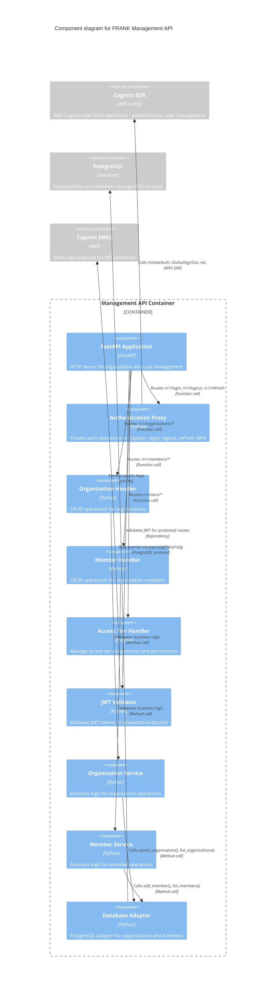

# FRANK Management API Components (C4 Level 3)

**Diagram Type**: C4 Component
**Container**: Management API (Organization & User Management)
**Last Updated**: 2026-02-06
**Related ADRs**: [ADR-0005](../../adr/0005-cognito-authentication.md), [ADR-0006](../../adr/0006-admin-mvc-architecture.md), [ADR-0009](../../adr/0009-postgresql-management-api.md)

## Purpose

This diagram shows the internal component structure of the **Management API** container. The Management API handles organization and user management, authentication operations, and access tier administration.

## Component Diagram



## Component Descriptions

### FastAPI Application
- **Technology**: FastAPI framework
- **File**: `src/frank/management/server.py`
- **Purpose**: HTTP server for organization and user management operations
- **Responsibilities**:
  - Route registration for management operations
  - CORS middleware
  - Dependency injection (database, Cognito service)
  - Error handling and HTTP status codes
- **Key Function**: `create_management_app(database, cognito_service) -> FastAPI`

### Authentication Proxy
- **File**: `src/frank/management/cognito_service.py`
- **Purpose**: Proxy authentication operations to AWS Cognito (stateless)
- **Key Operations**:
  - **Login**: `POST /v1/login`
    - Proxies to `Cognito.InitiateAuth()`
    - Returns JWT access token + refresh token
    - Handles MFA challenges (TOTP, SMS)
  - **Logout**: `POST /v1/logout`
    - Proxies to `Cognito.GlobalSignOut()`
    - Invalidates all user sessions
  - **Refresh Token**: `POST /v1/refresh`
    - Proxies to `Cognito.RefreshToken()`
    - Returns new JWT access token
  - **Change Password**: `POST /v1/change-password`
    - Proxies to `Cognito.ChangePassword()`
- **Design Philosophy per [ADR-0005](../../adr/0005-cognito-authentication.md)**:
  - **No local credential storage**: Cognito owns all passwords, MFA secrets
  - **Stateless proxy**: Management API doesn't store sessions or tokens
  - **Cognito for everything**: Token refresh, logout, user management all proxy to Cognito
- **Error Handling**: Maps Cognito exceptions to HTTP status codes

### Organization Handler
- **File**: `src/frank/management/server.py` (endpoint functions)
- **Routes**:
  - `GET /v1/organizations` - List all organizations
  - `POST /v1/organizations` - Create new organization
  - `GET /v1/organizations/{org_id}` - Get organization by ID
  - `PUT /v1/organizations/{org_id}` - Update organization
  - `DELETE /v1/organizations/{org_id}` - Delete organization (soft delete)
- **Request/Response Models**: Pydantic models in `src/frank/management/models.py`
- **Authorization**: Requires CORE_MEMBER access tier (admin only)
- **Process**:
  1. Validate JWT and check access tier
  2. Delegate to Organization Service
  3. Return HTTP response

### Member Handler
- **File**: `src/frank/management/server.py` (endpoint functions)
- **Routes**:
  - `GET /v1/members` - List members (filtered by organization if not admin)
  - `POST /v1/members` - Add member to organization
  - `GET /v1/members/{member_id}` - Get member details
  - `PUT /v1/members/{member_id}` - Update member (change role, tier)
  - `DELETE /v1/members/{member_id}` - Remove member from organization
- **Authorization**:
  - Admin (CORE_MEMBER): Can manage all organizations
  - Organization admin: Can manage own organization only
- **Process**:
  1. Validate JWT and extract org_id
  2. Check permissions (admin or same org)
  3. Delegate to Member Service
  4. Return HTTP response

### Access Tier Handler
- **File**: `src/frank/management/server.py`
- **Routes**:
  - `GET /v1/tiers` - List available access tiers with descriptions
  - `PUT /v1/organizations/{org_id}/tier` - Update organization access tier
- **Access Tiers** per [ADR-0003](../../adr/0003-tiered-access-control-model.md):
  - **PUBLIC**: Anyone, statistical summaries only
  - **OBSERVER**: View masked observables
  - **CONTRIBUTOR**: Submit data, view partial observables
  - **PARTNER**: Submit + query full observables
  - **CORE_MEMBER**: Full access + platform governance
- **Authorization**: Only CORE_MEMBER can change tiers
- **Business Logic**: Tier changes trigger Cognito group membership updates

### JWT Validator (Authentication Middleware)
- **File**: `src/frank/auth/dependencies.py`
- **Purpose**: Validate JWT tokens for protected endpoints
- **Same as Sightings API**: Shared authentication middleware
- **Process**:
  1. Extract Bearer token from `Authorization` header
  2. Fetch Cognito JWKS public keys
  3. Verify token signature, expiration, issuer
  4. Extract claims: user_id, org_id, access_tier
  5. Return `TokenPayload` object
- **Caching**: JWKS keys cached for 24 hours

### Organization Service
- **File**: `src/frank/management/services/organisation_service.py`
- **Purpose**: Business logic for organization operations
- **Responsibilities**:
  - Validate organization data (unique name, valid tier)
  - Enforce business rules (e.g., can't delete org with active members)
  - Audit logging (who created/modified organization)
  - Integration with Cognito groups (map tier to Cognito group)
- **Key Functions**:
  - `create_organisation(org_data: dict) -> Organisation`
  - `update_organisation(org_id: str, updates: dict) -> Organisation`
  - `delete_organisation(org_id: str, soft_delete: bool = True) -> bool`
  - `change_access_tier(org_id: str, new_tier: AccessTier) -> Organisation`

### Member Service
- **File**: `src/frank/management/services/member_service.py`
- **Purpose**: Business logic for member operations
- **Responsibilities**:
  - Validate member additions (user exists in Cognito, not already member)
  - Enforce business rules (org must have at least one admin)
  - Sync with Cognito groups (add user to tier-specific group)
  - Audit logging (who added/removed members)
- **Key Functions**:
  - `add_member(org_id: str, user_id: str, role: MemberRole) -> Member`
  - `remove_member(org_id: str, user_id: str) -> bool`
  - `update_member_role(member_id: str, new_role: MemberRole) -> Member`
  - `list_members_by_org(org_id: str) -> List[Member]`

### Database Adapter (PostgreSQL)
- **File**: `src/frank/storage/postgresql.py`
- **Purpose**: Persist organization and member data
- **Database**: PostgreSQL (RDS in production, local in Stage 1-2)
- **Tables**:
  - **organisations**:
    - `org_id` (UUID, primary key)
    - `name` (string, unique)
    - `access_tier` (enum: PUBLIC, OBSERVER, CONTRIBUTOR, PARTNER, CORE_MEMBER)
    - `created_at`, `updated_at` (timestamps)
    - `metadata` (JSONB, flexible additional data)
  - **organisation_members**:
    - `member_id` (UUID, primary key)
    - `org_id` (UUID, foreign key → organisations)
    - `user_id` (string, Cognito user ID)
    - `role` (enum: ADMIN, MEMBER)
    - `joined_at` (timestamp)
- **Key Methods**:
  - `upsert_organisation(org_data: dict) -> str`
  - `get_organisation_by_id(org_id: str) -> dict`
  - `list_organisations() -> List[dict]`
  - `add_member(org_id: str, user_id: str, role: str) -> str`
  - `list_members(org_id: str) -> List[dict]`
  - `delete_member(member_id: str) -> bool`
- **Why PostgreSQL?** See [ADR-0009](../../adr/0009-postgresql-management-api.md):
  - Relational data (organizations, members)
  - Foreign key constraints
  - Transactions for multi-step operations
  - Lower volume than threat intelligence data

## External Dependencies

### Cognito SDK (boto3)
- **Technology**: AWS SDK for Python (boto3)
- **Purpose**: Direct interaction with AWS Cognito User Pool
- **Operations**:
  - `InitiateAuth()` - Authenticate user, return JWT tokens
  - `GlobalSignOut()` - Invalidate all user sessions
  - `RefreshToken()` - Get new access token from refresh token
  - `CreateUser()` - Create new Cognito user (admin operation)
  - `AdminAddUserToGroup()` - Add user to Cognito group (for access tiers)
  - `AdminRemoveUserFromGroup()` - Remove user from Cognito group
  - `AdminUpdateUserAttributes()` - Update user metadata
- **Configuration**: User Pool ID, Client ID from environment variables

### PostgreSQL Database
- **Technology**: PostgreSQL 14+ (local or AWS RDS)
- **Connection**: Connection pooling via psycopg2 or asyncpg
- **Stage-Specific**:
  - **Stage 1**: Local SQLite (same schema)
  - **Stage 2**: Local PostgreSQL or LocalStack RDS
  - **Stage 3**: AWS RDS Multi-AZ
  - **Stage 4**: Self-hosted PostgreSQL in K8s or cloud RDS
- **Migrations**: Schema migrations via Alembic (not yet implemented, manual DDL)

### Cognito JWKS Endpoint
- **Same as Sightings API**: Shared public key endpoint
- **URL**: `https://cognito-idp.{region}.amazonaws.com/{user_pool_id}/.well-known/jwks.json`
- **Purpose**: JWT token validation (stateless)

## Data Flow Walkthrough

### Scenario: User Login

```
1. Client → Management API: POST /v1/login
   Body: {
     "username": "analyst@rabobank.nl",
     "password": "SecurePassword123!"
   }

2. FastAPI App → Authentication Proxy
   - Route /v1/login to auth_proxy.login()

3. Authentication Proxy → Cognito SDK
   - Call cognito.initiate_auth(
       AuthFlow='USER_PASSWORD_AUTH',
       AuthParameters={
         'USERNAME': 'analyst@rabobank.nl',
         'PASSWORD': 'SecurePassword123!'
       }
     )

4. Cognito validates credentials:
   - Check password hash
   - Verify account status (active, not locked)
   - Check MFA requirement

5. Cognito → Authentication Proxy
   - Return tokens:
     * access_token: "eyJhbGc..." (JWT, 1 hour expiry)
     * refresh_token: "..." (30 days expiry)
     * id_token: "..." (user profile)

6. Authentication Proxy → FastAPI App
   - Return LoginResponse:
     {
       "access_token": "eyJhbGc...",
       "refresh_token": "...",
       "expires_in": 3600,
       "token_type": "Bearer"
     }

7. FastAPI App → Client
   - HTTP 200 OK
   - Body: LoginResponse JSON

8. Client stores tokens:
   - access_token in memory or secure storage
   - refresh_token in secure HttpOnly cookie
```

### Scenario: Create Organization (Admin Only)

```
1. Admin → Management API: POST /v1/organizations
   Headers: Authorization: Bearer <admin-jwt>
   Body: {
     "name": "ASML",
     "access_tier": "CONTRIBUTOR"
   }

2. FastAPI App → JWT Validator
   - Validate admin JWT
   - Extract claims: {user_id: "admin-123", access_tier: AccessTier.CORE_MEMBER}
   - Check access_tier == CORE_MEMBER (admin permission)

3. JWT Validator → Organization Handler
   - Pass validated user context

4. Organization Handler → Organization Service
   - Call org_service.create_organisation({
       "name": "ASML",
       "access_tier": AccessTier.CONTRIBUTOR
     })

5. Organization Service:
   - Validate organization data:
     * Name is unique (check database)
     * Access tier is valid enum value
   - Generate org_id (UUID)
   - Prepare organization record:
     {
       "org_id": "org-<uuid>",
       "name": "ASML",
       "access_tier": "CONTRIBUTOR",
       "created_at": "2026-02-06T10:00:00Z"
     }

6. Organization Service → Database Adapter
   - Call database.upsert_organisation(org_data)

7. Database Adapter → PostgreSQL
   - Execute SQL: INSERT INTO organisations (org_id, name, access_tier, created_at) VALUES (?, ?, ?, ?)

8. PostgreSQL → Database Adapter
   - Return org_id

9. Database Adapter → Organization Service
   - Return org_id

10. Organization Service → Cognito SDK (optional, for future group creation)
    - Create Cognito group: "FRANK_CONTRIBUTOR_ASML"
    - (Optional: per-organization groups for isolation)

11. Organization Service → Organization Handler
    - Return Organization object

12. Organization Handler → FastAPI App
    - Return HTTP 201 Created
    - Body: {
        "org_id": "org-<uuid>",
        "name": "ASML",
        "access_tier": "CONTRIBUTOR"
      }
```

### Scenario: Add Member to Organization

```
1. Org Admin → Management API: POST /v1/members
   Headers: Authorization: Bearer <admin-jwt>
   Body: {
     "org_id": "org-456",
     "user_id": "user-789",
     "role": "MEMBER"
   }

2. FastAPI App → JWT Validator
   - Validate JWT, extract org_id of requester

3. JWT Validator → Member Handler
   - Pass user context

4. Member Handler → Member Service
   - Call member_service.add_member("org-456", "user-789", MemberRole.MEMBER)
   - Check permission: requester is admin OR requester is from same org AND has ADMIN role

5. Member Service:
   - Validate:
     * org-456 exists (query database)
     * user-789 exists in Cognito
     * user-789 not already member of org-456
   - Generate member_id (UUID)
   - Prepare member record

6. Member Service → Database Adapter
   - Call database.add_member("org-456", "user-789", "MEMBER")

7. Database Adapter → PostgreSQL
   - Execute SQL: INSERT INTO organisation_members (member_id, org_id, user_id, role, joined_at) VALUES (?, ?, ?, ?, ?)

8. PostgreSQL → Database Adapter
   - Return member_id

9. Database Adapter → Member Service
   - Return member_id

10. Member Service → Cognito SDK
    - Get organization access tier (CONTRIBUTOR)
    - Add user to Cognito group: cognito.admin_add_user_to_group(
        UserPoolId='...',
        Username='user-789',
        GroupName='FRANK_CONTRIBUTOR'
      )
    - This grants user CONTRIBUTOR-level access to Sightings API

11. Member Service → Member Handler
    - Return Member object

12. Member Handler → FastAPI App
    - Return HTTP 201 Created
    - Body: {
        "member_id": "member-<uuid>",
        "org_id": "org-456",
        "user_id": "user-789",
        "role": "MEMBER",
        "access_tier": "CONTRIBUTOR"  # Inherited from org
      }
```

## Design Principles

### Stateless Authentication Proxy
Per [ADR-0005](../../adr/0005-cognito-authentication.md):
- ❌ **No credential storage**: Management API never stores passwords, MFA secrets
- ❌ **No session storage**: No session tables, no session cookies
- ❌ **No token storage**: Tokens never persisted in database
- ✅ **Proxy only**: All auth operations delegate to Cognito
- ✅ **Stateless validation**: JWT validation via JWKS public keys

### Minimal Database Schema
Per [ADR-0009](../../adr/0009-postgresql-management-api.md):
- ✅ Store only business data: organizations, members
- ❌ No auth tables: No api_keys, refresh_tokens, sessions
- ✅ Foreign keys: Enforce referential integrity (org_id → organisations)
- ✅ Indexes: Fast lookups (user_id, org_id)

### Separation from Sightings API
- **Different container**: Management API is separate ECS task / K8s deployment
- **Different database**: PostgreSQL (relational) vs. DynamoDB (NoSQL)
- **Different scaling**: Low volume (dozens of req/min) vs. high volume (thousands)
- **Different access patterns**: CRUD operations vs. query-heavy workloads

## Related Documentation

### Container Diagrams
- **[Stage 1 Container](02-container-stage1.md)** - Management API in SQLite stage
- **[Stage 2 Container](02-container-stage2.md)** - Management API with PostgreSQL
- **[Stage 3 Container](02-container-stage3.md)** - Management API with RDS
- **[Stage 4 Container](02-container-stage4.md)** - Management API in Kubernetes

### Other Component Diagrams
- **[Sightings API Components](03-component-sightings.md)** - Threat intelligence API
- **[Storage Abstraction](03-component-storage.md)** - Database layer

### ADRs
- **[ADR-0005: AWS Cognito Authentication](../../adr/0005-cognito-authentication.md)** - Authentication strategy
- **[ADR-0006: Admin MVC Architecture](../../adr/0006-admin-mvc-architecture.md)** - Admin module design
- **[ADR-0009: PostgreSQL for Management API](../../adr/0009-postgresql-management-api.md)** - Database choice

### Source Code
- **Management API**: `src/frank/management/server.py`
- **Cognito Service**: `src/frank/management/cognito_service.py`
- **Organization Service**: `src/frank/management/services/organisation_service.py`
- **PostgreSQL Adapter**: `src/frank/storage/postgresql.py`

---

*Part of FRANK's C4 architecture documentation*
*See [C4 README](README.md) for navigation and [Context Diagram](01-context.md) for system overview*
