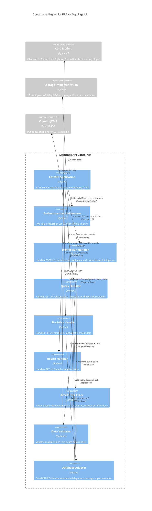

# FRANK Sightings API Components (C4 Level 3)

**Diagram Type**: C4 Component
**Container**: Sightings API (Threat Intelligence API)
**Last Updated**: 2026-02-06
**Related ADRs**: [ADR-0002](../../adr/0002-repository-pattern-database-abstraction.md), [ADR-0003](../../adr/0003-tiered-access-control-model.md), [ADR-0007](../../adr/0007-forgiving-input-strong-output.md)

## Purpose

This diagram shows the internal component structure of the **Sightings API** (Main API) container. The Sightings API handles high-volume threat intelligence operations: submitting observables, querying sightings, and retrieving statistics.

## Component Diagram



## Component Descriptions

### FastAPI Application
- **Technology**: FastAPI framework
- **File**: `src/frank/main/api.py`
- **Purpose**: HTTP server orchestration, routing, middleware
- **Responsibilities**:
  - Route registration (`@app.post("/v1/submissions")`)
  - CORS middleware configuration
  - Dependency injection (database, authentication)
  - OpenAPI documentation generation (`/docs`, `/redoc`)
  - Error handling and HTTP status codes
- **Key Function**: `create_main_app(database, cognito_service) -> FastAPI`

### Authentication Middleware
- **Technology**: FastAPI dependency system + PyJWT
- **File**: `src/frank/auth/dependencies.py`
- **Purpose**: Stateless JWT token validation
- **Process**:
  1. Extract `Authorization: Bearer <token>` header
  2. Fetch public keys from Cognito JWKS endpoint
  3. Verify token signature, expiration, issuer
  4. Extract claims: `user_id`, `org_id`, `access_tier` (from Cognito groups)
  5. Return `TokenPayload` object with user information
- **Key Function**: `get_current_user(token: str) -> TokenPayload`
- **Error Handling**: Returns 401 Unauthorized if token invalid/expired

### Submission Handler
- **File**: `src/frank/main/api.py` (endpoint function)
- **Route**: `POST /v1/submissions`
- **Purpose**: Receive and store threat intelligence submissions
- **Request Model**: `SubmissionRequest` (Pydantic)
  - `observables`: List of Observable objects (IPs, domains, hashes)
  - `severity`: SeverityLevel enum (low, medium, high, critical)
  - `confidence`: Integer 0-100
  - `description`: Optional text description
  - `threat_context`: Optional ThreatContext (campaign, TTPs)
- **Process**:
  1. Authenticate user via `get_current_user()` dependency
  2. Validate request body via Pydantic model
  3. Create `Submission` object with auto-generated ID
  4. Set submitter metadata from JWT claims
  5. Call `database.store_submission(submission)`
  6. Return `SubmissionResponse` with submission ID
- **Error Handling**:
  - 400 Bad Request: Validation errors
  - 401 Unauthorized: Invalid/missing JWT
  - 503 Service Unavailable: Database error

### Query Handler
- **File**: `src/frank/main/api.py` (endpoint function)
- **Route**: `GET /v1/observables`
- **Purpose**: Search and filter threat intelligence observables
- **Query Parameters**:
  - `type`: Observable type (ipv4, domain, hash, etc.)
  - `value`: Observable value (e.g., "192.0.2.1")
  - `severity`: Filter by severity level
  - `start_date`, `end_date`: Time range filter
  - `limit`, `offset`: Pagination
- **Process**:
  1. Authenticate user via `get_current_user()`
  2. Extract access tier from JWT claims
  3. Call `database.query_observables(filters)` → raw results
  4. Call `access_filter.filter_by_tier(results, access_tier)`
  5. Apply tier-specific filtering per [ADR-0003](../../adr/0003-tiered-access-control-model.md):
     - **PUBLIC**: Statistical summaries only (no observables)
     - **OBSERVER**: Masked observables (e.g., "192.0.2.x")
     - **CONTRIBUTOR**: Partial observables + campaign context
     - **PARTNER**: Full observables + attribution
     - **CORE_MEMBER**: Everything + submitter identity
  6. Return filtered results
- **Response**: List of Observable objects (filtered)

### Statistics Handler
- **File**: `src/frank/main/api.py`
- **Route**: `GET /v1/statistics`
- **Purpose**: Aggregate threat intelligence statistics
- **Query Parameters**:
  - `group_by`: severity, observable_type, timeframe
  - `start_date`, `end_date`: Time range
- **Process**:
  1. Authenticate user
  2. Call `database.get_statistics(group_by, time_range)`
  3. Return aggregated counts, trends, top observables
- **Response**: Statistics object with counts and trends

### Health Handler
- **File**: `src/frank/main/api.py`
- **Routes**:
  - `GET /v1/health` - Basic health check
  - `GET /v1/health/deep` - Deep health check with database connectivity
- **Purpose**: Service health monitoring (for ALB/Ingress health checks)
- **Response**:
  - Basic: `{"status": "healthy", "version": "0.1.0"}`
  - Deep: `{"status": "healthy", "database": "connected", "latency_ms": 5}`

### Access Tier Filter
- **File**: `src/frank/util/filter.py`
- **Purpose**: Implement five-tier access control per [ADR-0003](../../adr/0003-tiered-access-control-model.md)
- **Functions**:
  - `filter_observable_by_access_level(observable, access_tier) -> Observable`
  - `filter_submission_by_access_level(submission, access_tier) -> Submission`
- **Filtering Logic**:
  - **PUBLIC**: Return statistical summary only (no raw data)
  - **OBSERVER**: Mask IP last octet, hash first 8 chars, domain TLD only
  - **CONTRIBUTOR**: Partial observables, campaign context (no attribution)
  - **PARTNER**: Full observables, attribution, financial impact
  - **CORE_MEMBER**: Everything + submitter identity for cross-org coordination
- **Key Insight**: Business logic layer (`src/frank/core/`) defines access rules, filter applies them

### Data Validator
- **Technology**: Pydantic v2 models
- **File**: `src/frank/core/models.py`
- **Purpose**: Validate and normalize submission data
- **Models**:
  - `Submission` - Top-level submission model
  - `Observable` - IP, domain, hash, process observable
  - `Sighting` - Observation details
  - `Submitter` - Submitting organization metadata
  - `ThreatContext` - Campaign, TTPs, MITRE ATT&CK mapping
- **Validation Rules** per [ADR-0007](../../adr/0007-forgiving-input-strong-output.md):
  - **Forgiving on input**: Accept flexible formats, normalize data
  - **Strong on output**: Return validated, complete data models
  - Examples:
    - Accept IP as string or object, normalize to IPv4/IPv6 object
    - Accept timestamps in multiple formats, normalize to ISO 8601
    - Accept severity as string or enum, normalize to enum
- **Factory Methods**:
  - `Observable.create_ipv4(value)` - Create IP observable
  - `Submission.create_minimal(observables)` - Minimal submission
  - `Submission.from_legacy_dict(data)` - Import from legacy format

### Database Adapter
- **File**: `src/frank/storage/base.py` (abstract interface)
- **Purpose**: Stage-agnostic database operations
- **Interface**: `BaseFRANKDatabase` abstract base class
- **Key Methods**:
  - `store_submission(submission: Submission) -> str` - Store submission, return ID
  - `get_submission_by_id(submission_id: str, access_tier: AccessTier) -> Submission`
  - `query_observables(filters: dict, access_tier: AccessTier) -> List[Observable]`
  - `get_statistics(group_by: str, time_range: tuple) -> dict`
  - `health_check() -> dict` - Database connectivity check
- **Implementations** (stage-specific):
  - **Stage 1**: `SQLiteFRANKDatabase` (`src/frank/storage/sqlite.py`)
  - **Stage 2-3**: `DynamoDBFRANKDatabase` (`src/frank/storage/dynamodb.py`)
  - **Stage 4**: `ScyllaDBFRANKDatabase` (`src/frank/storage/scylladb.py`) (future)
- **Key Principle**: Same interface across all stages, different backend implementations

## External Dependencies

### Core Models (Business Logic Layer)
- **Location**: `src/frank/core/models.py`
- **Purpose**: Stage-agnostic data models and business logic
- **Key Classes**:
  - `Observable` - Threat indicator (IP, domain, hash, process)
  - `Submission` - Complete threat intelligence submission
  - `Sighting` - Observation details with timestamp
  - `Submitter` - Submitting organization with access tier
  - `ThreatContext` - Campaign attribution, MITRE ATT&CK TTPs
- **Why External**: Business logic separated from API layer per [ADR-0002](../../adr/0002-repository-pattern-database-abstraction.md)

### Storage Implementation
- **Location**: `src/frank/storage/` (stage-specific files)
- **Purpose**: Persist threat intelligence data
- **Implementations**:
  - **SQLite**: `sqlite.py` (Stage 1)
  - **DynamoDB**: `dynamodb.py` (Stage 2-3)
  - **PostgreSQL**: `postgresql.py` (Management API only, not for sightings)
  - **ScyllaDB**: `scylladb.py` (Stage 4, future)
- **Why External**: Infrastructure layer separated from API layer (same core logic, different storage)

### Cognito JWKS Endpoint
- **Location**: External AWS service or OAuth2 provider
- **URL**: `https://cognito-idp.{region}.amazonaws.com/{user_pool_id}/.well-known/jwks.json`
- **Purpose**: Public key distribution for JWT validation
- **Process**:
  1. Sightings API fetches public keys on startup
  2. Caches keys for 24 hours
  3. Refreshes keys on signature verification failure
  4. Validates JWT tokens using public key
- **Stateless**: No local session storage, fully stateless authentication

## Data Flow Walkthrough

### Scenario: Submit Threat Intelligence

```
1. Client → FastAPI App: POST /v1/submissions
   Headers: Authorization: Bearer eyJhbGc...
   Body: {
     "observables": [
       {"type": "ipv4", "value": "203.0.113.42"},
       {"type": "domain", "value": "evil.com"}
     ],
     "severity": "critical",
     "confidence": 90
   }

2. FastAPI App → Authentication Middleware
   - Extract Bearer token
   - Validate JWT via Cognito JWKS
   - Extract claims: {user_id: "user-123", org_id: "org-456", groups: ["FRANK_PARTNER"]}

3. Authentication Middleware → Submission Handler
   - Pass TokenPayload with user info

4. Submission Handler → Data Validator (Pydantic)
   - Validate request body
   - Create Submission object:
     * id: submission--<uuid>
     * observables: [Observable(type=ipv4, value=203.0.113.42), Observable(type=domain, value=evil.com)]
     * severity: SeverityLevel.CRITICAL
     * confidence: 90
     * submitter: Submitter(org_id="org-456", access_tier=AccessTier.PARTNER)
     * timestamp: 2026-02-06T10:30:00Z

5. Submission Handler → Database Adapter
   - Call database.store_submission(submission)

6. Database Adapter → Storage Implementation (SQLite/DynamoDB/ScyllaDB)
   - Write submission metadata
   - Write observable records
   - Write reverse lookup entries (for queries)

7. Storage Implementation → Database Adapter
   - Return submission_id

8. Database Adapter → Submission Handler
   - Return submission_id

9. Submission Handler → FastAPI App
   - Return SubmissionResponse:
     {
       "submission_id": "submission--<uuid>",
       "status": "accepted",
       "observables_count": 2
     }

10. FastAPI App → Client
    - HTTP 201 Created
    - Body: SubmissionResponse JSON
```

### Scenario: Query Observables with Access Tier Filtering

```
1. Client (OBSERVER tier) → FastAPI App: GET /v1/observables?type=ipv4&value=203.0.113.42

2. FastAPI App → Authentication Middleware
   - Validate JWT
   - Extract access_tier: AccessTier.OBSERVER

3. Authentication Middleware → Query Handler
   - Pass TokenPayload(access_tier=AccessTier.OBSERVER)

4. Query Handler → Database Adapter
   - Call database.query_observables(filters={"type": "ipv4", "value": "203.0.113.42"})

5. Database Adapter → Storage Implementation
   - Query database for matching observables
   - Return raw results (no filtering yet)

6. Storage Implementation → Database Adapter
   - Return: [
       Observable(type=ipv4, value="203.0.113.42", submitter=Submitter(...)),
       Observable(type=ipv4, value="203.0.113.42", submitter=Submitter(...))
     ]

7. Database Adapter → Query Handler
   - Return raw observable list

8. Query Handler → Access Tier Filter
   - Call filter_observable_by_access_level(observable, AccessTier.OBSERVER)
   - OBSERVER tier filtering:
     * Mask IP last octet: "203.0.113.42" → "203.0.113.x"
     * Remove submitter identity
     * Remove attribution data
     * Keep severity, confidence, timestamp

9. Access Tier Filter → Query Handler
   - Return filtered observables

10. Query Handler → FastAPI App
    - Return filtered observable list

11. FastAPI App → Client
    - HTTP 200 OK
    - Body: [
        {
          "type": "ipv4",
          "value": "203.0.113.x",  # Masked
          "severity": "critical",
          "confidence": 90,
          "timestamp": "2026-02-06T10:30:00Z"
          # No submitter identity
        }
      ]
```

## Component Characteristics

### Stateless Design
- ✅ No session storage in API
- ✅ JWT tokens contain all user context
- ✅ Horizontal scaling without shared state
- ✅ Each request independent (no session affinity)

### Separation of Concerns
- ✅ **API Layer**: HTTP routing, request/response handling (this diagram)
- ✅ **Business Logic**: Core models, validation, access rules (`src/frank/core/`)
- ✅ **Infrastructure**: Database implementations (`src/frank/storage/`)

### Stage-Agnostic Components
- ✅ **Same code across all stages**: FastAPI app, handlers, validators
- ✅ **Only storage implementation changes**: SQLite → DynamoDB → ScyllaDB
- ✅ **Business logic never changes**: Core models, access tier filtering

## Related Documentation

### Container Diagrams
- **[Stage 1 Container](02-container-stage1.md)** - Sightings API in SQLite stage
- **[Stage 2 Container](02-container-stage2.md)** - Sightings API in LocalStack stage
- **[Stage 3 Container](02-container-stage3.md)** - Sightings API in AWS Cloud stage
- **[Stage 4 Container](02-container-stage4.md)** - Sightings API in Kubernetes stage

### Other Component Diagrams
- **[Management API Components](03-component-management.md)** - Organization/user management
- **[Storage Abstraction](03-component-storage.md)** - Database layer details

### ADRs
- **[ADR-0002: Repository Pattern](../../adr/0002-repository-pattern-database-abstraction.md)** - Database abstraction design
- **[ADR-0003: Tiered Access Control](../../adr/0003-tiered-access-control-model.md)** - Five-tier access model
- **[ADR-0007: Forgiving Input, Strong Output](../../adr/0007-forgiving-input-strong-output.md)** - Data validation philosophy

### Specifications
- **[Sighting Spec](../../../specs/core/sighting.spec.md)** - Behavioral requirements
- **[Observable Spec](../../../specs/core/observable.spec.md)** - Observable data model
- **[Submission Spec](../../../specs/core/submission.spec.md)** - Submission workflow

### Source Code
- **FastAPI App**: `src/frank/main/api.py`
- **Core Models**: `src/frank/core/models.py`
- **Access Filter**: `src/frank/util/filter.py`
- **Storage Interface**: `src/frank/storage/base.py`
- **SQLite Impl**: `src/frank/storage/sqlite.py`
- **DynamoDB Impl**: `src/frank/storage/dynamodb.py`

---

*Part of FRANK's C4 architecture documentation*
*See [C4 README](README.md) for navigation and [Context Diagram](01-context.md) for system overview*
