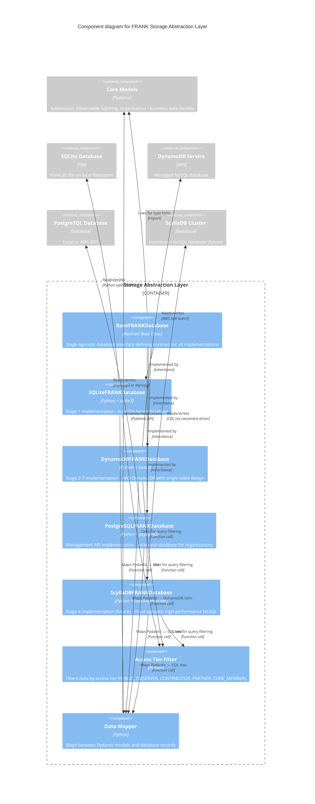

# FRANK Storage Abstraction Components (C4 Level 3)

**Diagram Type**: C4 Component
**Container**: Storage Abstraction Layer
**Last Updated**: 2026-02-06
**Related ADRs**: [ADR-0001](../../adr/0001-four-stage-infrastructure-evolution.md), [ADR-0002](../../adr/0002-repository-pattern-database-abstraction.md)

## Purpose

This diagram shows the **Storage Abstraction Layer** that enables FRANK's core business logic to run unchanged across all four infrastructure stages. The same code works with SQLite (Stage 1), DynamoDB (Stages 2-3), and ScyllaDB (Stage 4) through a common interface.

**Key Principle**: One interface (`BaseFRANKDatabase`), multiple implementations (SQLite, DynamoDB, PostgreSQL, ScyllaDB).

## Component Diagram



## Component Descriptions

### BaseFRANKDatabase (Abstract Interface)
- **Technology**: Python abstract base class (ABC)
- **File**: `src/frank/storage/base.py`
- **Purpose**: Define stage-agnostic database contract
- **Key Methods**:

**Submission Operations**:
  - `store_submission(submission: Submission) -> str`
  - `get_submission_by_id(submission_id: str, access_tier: AccessTier) -> Optional[Submission]`
  - `list_submissions(filters: dict, access_tier: AccessTier) -> List[Submission]`

**Observable Operations**:
  - `query_observables(filters: dict, access_tier: AccessTier) -> List[Observable]`
  - `get_observable_by_id(observable_id: str, access_tier: AccessTier) -> Optional[Observable]`

**Statistics Operations**:
  - `get_statistics(group_by: str, time_range: tuple, access_tier: AccessTier) -> dict`

**Organization Operations** (Management API):
  - `upsert_organisation(org_data: dict) -> str`
  - `get_organisation_by_id(org_id: str) -> Optional[dict]`
  - `list_organisations() -> List[dict]`
  - `add_member(org_id: str, user_id: str, role: str) -> str`
  - `list_members(org_id: str) -> List[dict]`

**Health Check**:
  - `health_check() -> dict` - Database connectivity and status

**Design per [ADR-0002](../../adr/0002-repository-pattern-database-abstraction.md)**:
- ✅ Repository pattern: Database is a repository of domain objects
- ✅ Access control built-in: All query methods require `access_tier` parameter
- ✅ Stage-agnostic: Interface doesn't expose database-specific details
- ✅ Testable: Mock implementations for unit testing

### SQLiteFRANKDatabase
- **Technology**: Python sqlite3 module
- **File**: `src/frank/storage/sqlite.py`
- **Purpose**: Stage 1 implementation for local development
- **Database**: Single SQLite file (`frank.db` or configured path)
- **Tables**:
  - `submissions` - Threat intelligence submissions
  - `observables` - IPs, domains, hashes, processes
  - `sightings` - Observation details
  - `submitters` - Submitting organizations
  - `organisations` - Organization records
  - `organisation_members` - Member associations
- **Schema Design**:
  - Normalized relational design
  - Foreign keys: `submissions.id` ← `observables.submission_id`
  - Indexes: `observables(type, value)`, `submissions(created_at)`
- **Query Patterns**:
  - SQL SELECT with WHERE clauses
  - JOIN for related data (submissions + observables)
  - Aggregate queries for statistics (COUNT, GROUP BY)
- **Strengths**:
  - ✅ Zero configuration (no server required)
  - ✅ Fast for small datasets (< 100k submissions)
  - ✅ Perfect for development and testing
- **Limitations**:
  - ❌ Single-user (file locking issues with concurrency)
  - ❌ Limited scale (not suitable for production volumes)

### DynamoDBFRANKDatabase
- **Technology**: AWS SDK for Python (boto3)
- **File**: `src/frank/storage/dynamodb.py`
- **Purpose**: Stages 2-3 implementation for cloud-native threat intelligence storage
- **Database**: AWS DynamoDB or LocalStack simulation
- **Table Design**: **Single-table design pattern**
  - Table: `frank-submissions`
  - Partition Key: `pk` (string) - Entity type prefix (e.g., `SUB#uuid`, `IP#value`)
  - Sort Key: `sk` (string) - Relationship or timestamp
  - Attributes: `data` (map), `created_at`, `severity`, etc.
- **Access Patterns**:
  - Get submission by ID: `pk=SUB#<uuid>`, `sk=METADATA`
  - Get observables for submission: `pk=SUB#<uuid>`, `sk` begins_with `OBS#`
  - Query by observable: `pk=IP#192.0.2.1`, `sk=SUB#<uuid>`
  - Query by severity: GSI on `severity` + `created_at`
  - Query by organization: GSI on `submitter_org_id`
- **Global Secondary Indexes (GSI)**:
  - `ObservableTypeIndex`: `pk=observable_type`, `sk=observable_value`
  - `OrganizationIndex`: `pk=org_id`, `sk=created_at`
  - `SeverityIndex`: `pk=severity`, `sk=created_at`
- **Single-Table Design Benefits**:
  - ✅ One table to manage (no JOINs)
  - ✅ Related entities fetched in single query
  - ✅ Lower cost (one table = one read/write capacity pool)
  - ✅ Consistent performance at scale
- **Capacity Mode**: On-demand (pay per request) in production
- **Strengths**:
  - ✅ Fully managed (no servers, auto-scaling)
  - ✅ High throughput (thousands of writes/second)
  - ✅ Low latency (single-digit milliseconds)
  - ✅ Suitable for production volumes (millions of submissions)
- **Limitations**:
  - ❌ AWS-specific (vendor lock-in)
  - ❌ Limited query flexibility (must design access patterns upfront)
  - ❌ Cost at high scale (expensive for large datasets)

### PostgreSQLFRANKDatabase
- **Technology**: psycopg2 or asyncpg (PostgreSQL adapter)
- **File**: `src/frank/storage/postgresql.py`
- **Purpose**: Management API implementation for organizations and members
- **Database**: PostgreSQL 14+ (local, RDS, or cloud-managed)
- **Tables**:
  - `organisations` - Organization records
  - `organisation_members` - Member associations
- **Schema Design**:
  - Relational with foreign keys
  - Indexes on `org_id`, `user_id`
  - JSONB column for flexible metadata
- **Why PostgreSQL for Management API?** See [ADR-0009](../../adr/0009-postgresql-management-api.md):
  - ✅ Relational data (organizations, members)
  - ✅ ACID transactions (add member + update org atomically)
  - ✅ Foreign key constraints (referential integrity)
  - ✅ Lower volume (hundreds of orgs, thousands of members)
- **Connection Pooling**: 20 max connections per task
- **Strengths**:
  - ✅ Mature, reliable, well-understood
  - ✅ Rich query capabilities (SQL)
  - ✅ ACID guarantees
- **Limitations**:
  - ❌ Not suitable for high-volume writes (threat intelligence)
  - ❌ Vertical scaling limits (single-node for writes)

### ScyllaDBFRANKDatabase (Future)
- **Technology**: Cassandra Python driver (CQL)
- **File**: `src/frank/storage/scylladb.py` (not yet implemented)
- **Purpose**: Stage 4 implementation for cloud-agnostic massive scale
- **Database**: ScyllaDB cluster (Cassandra-compatible)
- **Table Design**: Same single-table pattern as DynamoDB
  - Compatible CQL schema
  - Partition key: `pk`, Clustering key: `sk`
  - Materialized views for reverse lookups
- **Cluster Topology**:
  - 3-9 nodes (replication factor 3)
  - Shard-per-core architecture (no GC pauses)
  - Local SSD/NVMe storage
- **Query Language**: CQL (Cassandra Query Language)
  - Similar to SQL, but NoSQL semantics
  - Prepared statements for performance
- **Migration from DynamoDB**:
  - Export DynamoDB data to S3 (JSON)
  - Import to ScyllaDB using CQL COPY or custom loader
  - Dual-write during migration period
- **Strengths**:
  - ✅ 10x faster than Cassandra (C++ implementation)
  - ✅ Cloud-agnostic (deploy anywhere)
  - ✅ Massive scale (petabytes of data)
  - ✅ Multi-region replication
  - ✅ Lower cost than DynamoDB at scale
- **Limitations**:
  - ❌ Operational complexity (cluster management)
  - ❌ Requires Kubernetes or VM management

### Access Tier Filter
- **File**: `src/frank/util/filter.py`
- **Purpose**: Implement five-tier access control per [ADR-0003](../../adr/0003-tiered-access-control-model.md)
- **Used by**: All storage implementations (except PostgreSQL)
- **Functions**:
  - `_filter_observable_by_access_level(observable: Observable, access_tier: AccessTier) -> Observable`
  - `_filter_submission_by_access_level(submission: Submission, access_tier: AccessTier) -> Submission`
- **Filtering Rules** (see [Sightings API Components](03-component-sightings.md) for details)
- **Design**: Shared utility used by all storage adapters

### Data Mapper
- **File**: `src/frank/storage/base.py` and implementation-specific files
- **Purpose**: Map between Pydantic models and database records
- **Operations**:
  - **Serialize**: Pydantic model → database record (dict, DynamoDB item, SQL row)
  - **Deserialize**: Database record → Pydantic model
- **Stage-Specific Mappings**:
  - **SQLite**: Pydantic → flat dict → SQL INSERT
  - **DynamoDB**: Pydantic → nested dict → DynamoDB PutItem (with pk/sk)
  - **PostgreSQL**: Pydantic → flat dict → SQL INSERT (relational)
  - **ScyllaDB**: Pydantic → nested dict → CQL INSERT (with pk/sk)
- **Date/Time Handling**: Convert between Python datetime ↔ ISO 8601 string
- **Enum Handling**: Convert between Python enum ↔ string value
- **UUID Handling**: Generate/parse STIX-compliant IDs (e.g., `submission--<uuid>`)

## Stage-Agnostic Design

### Key Insight from ADR-0002

**Same Interface, Different Backend**:
```python
# Business logic (src/frank/core/) - NEVER CHANGES
submission = Submission(observables=[...], severity=SeverityLevel.HIGH)

# Storage abstraction - SAME INTERFACE
database: BaseFRANKDatabase = get_database()  # Returns stage-specific impl
submission_id = database.store_submission(submission)

# Stage 1: SQLite
database = SQLiteFRANKDatabase("frank.db")

# Stage 2-3: DynamoDB
database = DynamoDBFRANKDatabase("frank-submissions", endpoint_url=...)

# Stage 4: ScyllaDB (future)
database = ScyllaDBFRANKDatabase(contact_points=["node1", "node2"])
```

### Evolution Path: Same Code, Different Storage

| Stage | Database | Implementation File | Code Changes |
|-------|----------|---------------------|--------------|
| **Stage 1** | SQLite | `sqlite.py` | Initial implementation |
| **Stage 2** | DynamoDB (LocalStack) | `dynamodb.py` | Add new file, **core unchanged** |
| **Stage 3** | DynamoDB (AWS) | `dynamodb.py` | Config change only, **core unchanged** |
| **Stage 4** | ScyllaDB | `scylladb.py` | Add new file, **core unchanged** |

**What Changes**: Infrastructure adapter (`src/frank/storage/*.py`)
**What Doesn't Change**: Business logic (`src/frank/core/`), API layer (`src/frank/main/`)

## Implementation Comparison

### Submission Storage Comparison

**SQLite**:
```python
def store_submission(self, submission: Submission) -> str:
    conn = sqlite3.connect(self.db_path)
    cursor = conn.cursor()

    # Store submission
    cursor.execute(
        "INSERT INTO submissions (id, severity, confidence, created_at) VALUES (?, ?, ?, ?)",
        (submission.id, submission.severity.value, submission.confidence, submission.created_at)
    )

    # Store observables
    for obs in submission.observables:
        cursor.execute(
            "INSERT INTO observables (id, type, value, submission_id) VALUES (?, ?, ?, ?)",
            (obs.id, obs.type.value, obs.value, submission.id)
        )

    conn.commit()
    return submission.id
```

**DynamoDB**:
```python
def store_submission(self, submission: Submission) -> str:
    table = self.dynamodb.Table(self.table_name)

    # Store submission metadata
    table.put_item(Item={
        'pk': f'SUB#{submission.id}',
        'sk': 'METADATA',
        'data': submission.model_dump(),
        'created_at': submission.created_at.isoformat()
    })

    # Store observables
    for i, obs in enumerate(submission.observables):
        table.put_item(Item={
            'pk': f'SUB#{submission.id}',
            'sk': f'OBS#{i}',
            'data': obs.model_dump()
        })

        # Reverse lookup
        table.put_item(Item={
            'pk': f'{obs.type.value.upper()}#{obs.value}',
            'sk': f'SUB#{submission.id}',
            'submission_id': submission.id
        })

    return submission.id
```

**ScyllaDB** (Future):
```python
def store_submission(self, submission: Submission) -> str:
    session = self.cluster.connect(self.keyspace)

    # Prepared statement for performance
    insert_stmt = session.prepare(
        "INSERT INTO frank_data (pk, sk, data, created_at) VALUES (?, ?, ?, ?)"
    )

    # Store submission
    session.execute(insert_stmt, (
        f'SUB#{submission.id}',
        'METADATA',
        submission.model_dump_json(),
        submission.created_at
    ))

    # Store observables (similar pattern to DynamoDB)
    ...

    return submission.id
```

**Key Observation**: Implementation details differ, but **interface is identical**. Business logic never knows which database it's using.

## Testing Strategy

### Unit Testing with Mock Database

```python
# tests/unit/storage/test_basefrankdatabase.py

class MockFRANKDatabase(BaseFRANKDatabase):
    """Mock implementation for testing"""
    def __init__(self):
        self.submissions = {}

    def store_submission(self, submission: Submission) -> str:
        self.submissions[submission.id] = submission
        return submission.id

    def get_submission_by_id(self, submission_id: str, access_tier: AccessTier) -> Optional[Submission]:
        return self.submissions.get(submission_id)

# Test business logic with mock
def test_submission_workflow():
    db = MockFRANKDatabase()
    submission = Submission.create_minimal([Observable.create_ipv4("192.0.2.1")])

    submission_id = db.store_submission(submission)
    retrieved = db.get_submission_by_id(submission_id, AccessTier.PARTNER)

    assert retrieved.id == submission.id
```

### Integration Testing per Stage

```python
# tests/integration/test_sqlite_storage.py
def test_sqlite_storage_integration():
    db = SQLiteFRANKDatabase(":memory:")  # In-memory SQLite
    # ... test real SQLite operations

# tests/integration/test_dynamodb_storage.py
def test_dynamodb_storage_integration():
    db = DynamoDBFRANKDatabase("test-table", endpoint_url="http://localhost:4566")  # LocalStack
    # ... test real DynamoDB operations
```

## Related Documentation

### Container Diagrams
- **[Stage 1 Container](02-container-stage1.md)** - SQLite deployment
- **[Stage 2 Container](02-container-stage2.md)** - DynamoDB (LocalStack) deployment
- **[Stage 3 Container](02-container-stage3.md)** - DynamoDB (AWS) deployment
- **[Stage 4 Container](02-container-stage4.md)** - ScyllaDB deployment

### Other Component Diagrams
- **[Sightings API Components](03-component-sightings.md)** - Uses storage abstraction
- **[Management API Components](03-component-management.md)** - Uses PostgreSQL storage

### ADRs
- **[ADR-0001: Four-Stage Evolution](../../adr/0001-four-stage-infrastructure-evolution.md)** - Why staged approach?
- **[ADR-0002: Repository Pattern](../../adr/0002-repository-pattern-database-abstraction.md)** - Storage abstraction design
- **[ADR-0009: PostgreSQL for Management API](../../adr/0009-postgresql-management-api.md)** - Why PostgreSQL?

### Specifications
- **[Base Interface Spec](../../../specs/storage/base-interface.spec.md)** - BaseFRANKDatabase contract
- **[SQLite Storage Spec](../../../specs/storage/sqlite.spec.md)** - SQLite implementation
- **[DynamoDB Storage Spec](../../../specs/storage/dynamodb.spec.md)** - DynamoDB implementation

### Source Code
- **Base Interface**: `src/frank/storage/base.py`
- **SQLite Impl**: `src/frank/storage/sqlite.py`
- **DynamoDB Impl**: `src/frank/storage/dynamodb.py`
- **PostgreSQL Impl**: `src/frank/storage/postgresql.py`
- **Access Filter**: `src/frank/util/filter.py`

---

*Part of FRANK's C4 architecture documentation*
*See [C4 README](README.md) for navigation and [Context Diagram](01-context.md) for system overview*
