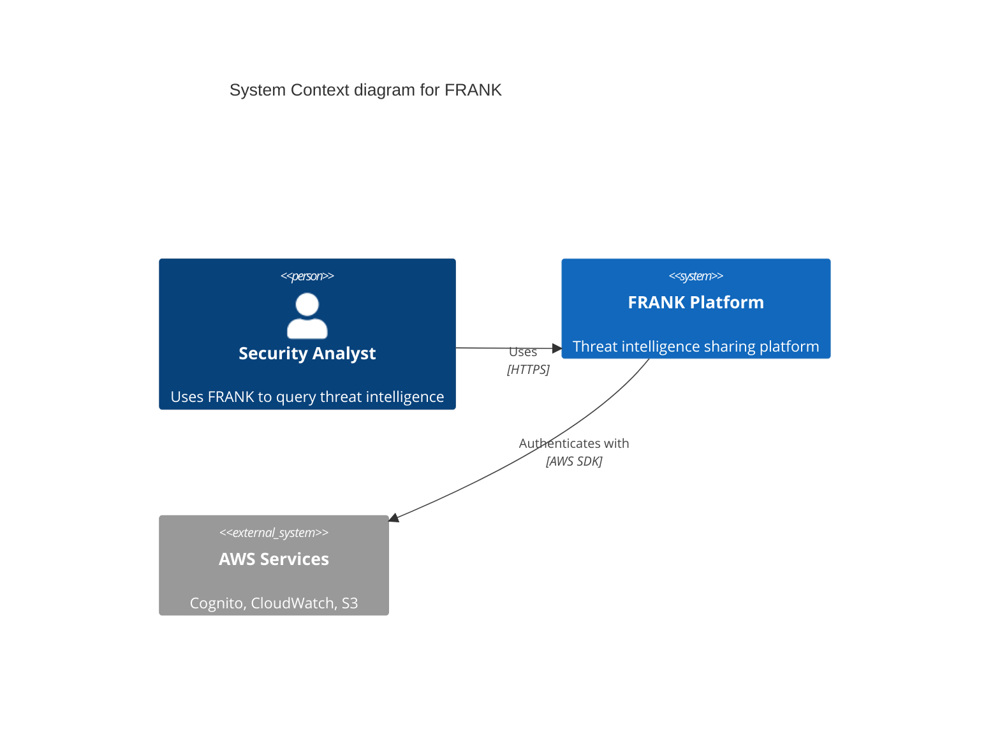

# FRANK C4 Architecture Diagrams

Visual architecture documentation using the [C4 model](https://c4model.com/) for software architecture.

## What is C4?

The C4 model provides a hierarchical way to visualize software architecture through four levels:

1. **Context** - System boundaries, users, and external dependencies
2. **Container** - High-level technology choices and their interactions
3. **Component** - Major structural building blocks within containers
4. **Code** - Class-level details (typically skipped in favor of specifications)

## FRANK C4 Documentation Structure

### Level 1: Context Diagram
- **[01-context.md](01-context.md)** - FRANK system context with users and external systems

Shows the big picture: how FRANK fits in its environment, who uses it, and what it depends on.

### Level 2: Container Diagrams

Container diagrams show FRANK's **evolutionary architecture** across four stages:

- **[02-container-stage1.md](02-container-stage1.md)** - Stage 1: SQLite + FastAPI (local development)
- **[02-container-stage2.md](02-container-stage2.md)** - Stage 2: LocalStack + DynamoDB/MySQL (cloud patterns)
- **[02-container-stage3.md](02-container-stage3.md)** - Stage 3: AWS ECS + DynamoDB + RDS (cloud deployment)
- **[02-container-stage4.md](02-container-stage4.md)** - Stage 4: Kubernetes + ScyllaDB (production scale)

Each stage shows:
- Technology choices (databases, APIs, services)
- Deployment architecture
- Infrastructure components
- Network boundaries

### Level 3: Component Diagrams

Component diagrams zoom into specific containers to show internal structure:

- **[03-component-sightings.md](03-component-sightings.md)** - Sightings API internals
- **[03-component-management.md](03-component-management.md)** - Management API internals
- **[03-component-storage.md](03-component-storage.md)** - Storage abstraction layer

### Level 4: Code Diagrams

**Intentionally omitted** - FRANK uses formal specifications (see `specs/` directory) and Python code for this level of detail.

## Diagram Notation

All diagrams use **Mermaid C4 syntax** for GitHub-native rendering:

### C4 Element Types

- **Person** - Human users
- **System** - Software system boundary
- **System_Ext** - External system (outside our control)
- **Container** - Application/service/database
- **Component** - Module/package within container
- **Rel** - Relationship between elements

### Color Conventions

Mermaid C4 uses default colors, but conceptually:
- **Blue** - Internal systems we control
- **Gray** - External systems/services
- **Green** - Databases/data stores

## How to Read These Diagrams

### Start with Context (Level 1)
Understand FRANK's role in the ecosystem:
- Who are the users?
- What external systems does FRANK interact with?
- What are the system boundaries?

### Understand Evolution (Level 2 - Containers)
See how FRANK's deployment architecture evolves:
- **Stage 1** → Proof of concept on laptop (SQLite)
- **Stage 2** → Learning cloud patterns (LocalStack)
- **Stage 3** → Production cloud deployment (AWS)
- **Stage 4** → Cloud-agnostic scale (Kubernetes)

### Dive into Details (Level 3 - Components)
Explore internal structure of key containers:
- How does the Sightings API handle submissions?
- What components make up the Management API?
- How does storage abstraction work across stages?

## Relationship to Other Documentation

### C4 Diagrams ↔ ADRs
- **[ADR-0001](../../adr/0001-four-stage-infrastructure-evolution.md)** - Defines the four stages shown in Container diagrams
- **[ADR-0002](../../adr/0002-repository-pattern-database-abstraction.md)** - Storage abstraction shown in Component diagrams
- **[ADR-0003](../../adr/0003-tiered-access-control-model.md)** - Access control components in Sightings/Management APIs
- **[ADR-0005](../../adr/0005-cognito-authentication.md)** - Authentication flows shown in Container diagrams
- **[ADR-0010](../../adr/0010-stages-vs-environments.md)** - Stage vs environment distinction in Container diagrams
- **[ADR-0013](../../adr/0013-c4-model-architecture-visualization.md)** - Decision to adopt C4 model

### C4 Diagrams ↔ Specifications
- **Specs** (`specs/`) document **behavior** (what components do)
- **C4 diagrams** document **structure** (how components relate)
- Example: `specs/apis/sightings_api.spec.md` defines API requirements, `03-component-sightings.md` shows how components are organized

### C4 Diagrams ↔ High-Level Design
- **[highlevel_design.md](../../highlevel_design.md)** - Textual architecture description with ASCII art
- **[hld_functional.md](../../hld_functional.md)** - Business/functional context
- C4 diagrams provide **formal visual representation** of these documents

## Diagram Maintenance

### When to Update C4 Diagrams

Update diagrams when:
- **New container added** (new API service, new database)
- **Container relationships change** (new integration, removed dependency)
- **Component structure evolves** (refactoring, new modules)
- **Stage architecture changes** (different deployment strategy)
- **External dependencies added** (new AWS service, third-party API)

### How to Update

1. Edit the appropriate `.md` file
2. Update the Mermaid code block
3. Verify rendering in GitHub preview or local Mermaid viewer
4. Update ADRs if architectural decision changed
5. Cross-reference new components in specifications

### Rendering Diagrams

**GitHub**: Mermaid renders automatically in GitHub web UI

**Local Preview**:
- VS Code: Install "Markdown Preview Mermaid Support" extension
- CLI: Use `mermaid-cli` (mmdc) to generate images
- Browser: Use Mermaid Live Editor (https://mermaid.live/)

## Quick Navigation

| Start Here | Then Explore | Finally Dive Into |
|------------|--------------|-------------------|
| [Context Diagram](01-context.md) | [Stage 1 Containers](02-container-stage1.md) | [Sightings API Components](03-component-sightings.md) |
| | [Stage 2 Containers](02-container-stage2.md) | [Management API Components](03-component-management.md) |
| | [Stage 3 Containers](02-container-stage3.md) | [Storage Abstraction](03-component-storage.md) |
| | [Stage 4 Containers](02-container-stage4.md) | |

## Contributing

When adding or modifying C4 diagrams:

1. **Follow C4 notation** - Use standard Person, System, Container, Component elements
2. **Keep it simple** - Avoid cluttering diagrams with excessive detail
3. **Use consistent naming** - Match names in code, specs, and ADRs
4. **Add descriptions** - Every element should have a brief description
5. **Show relationships** - Use Rel() to clarify interactions
6. **Cross-reference** - Link to relevant ADRs and specifications
7. **Test rendering** - Verify Mermaid syntax before committing

## External Resources

- **C4 Model Official Site**: https://c4model.com/
- **C4 Model Introduction**: https://c4model.com/introduction
- **Mermaid C4 Diagrams**: https://mermaid.js.org/syntax/c4.html
- **Mermaid Live Editor**: https://mermaid.live/
- **PlantUML C4 Extension** (alternative): https://github.com/plantuml-stdlib/C4-PlantUML

## Questions?

- Check related ADRs (especially ADR-0013)
- Review existing C4 diagrams for examples
- Consult [highlevel_design.md](../../highlevel_design.md) for textual descriptions
- See [specs/README.md](../../../specs/README.md) for behavioral specifications

---

*Part of FRANK's evolutionary architecture documentation*
*See [ADR-0013](../../adr/0013-c4-model-architecture-visualization.md) for architectural decision*
