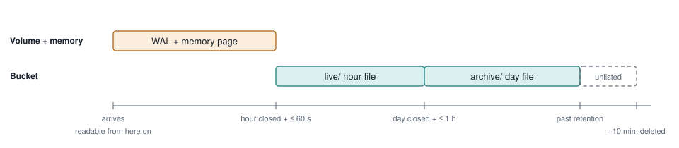

# How sightings are written and read

FRANK v0.46.0 on db-core v0.240.1, with `FRANK_STORE=s3://…` ([ADR-016](../.openspec/architecture/decisions/016-phase3-rust-on-db-core.md), [ADR-019](../.openspec/architecture/decisions/019-sightings-in-s3-state-on-a-volume.md), [spec 020](../.openspec/specs/020-sightings-storage/spec.md)).

Sightings live in one striped db-core table: a write-ahead log and in-memory pages for the open hour, one Parquet file per closed hour in `live/`, one per closed day in `archive/`. FRANK decides what a row is, when to flush and which SQL to run; db-core owns durability, the Parquet layout, the manifest, pruning and the cache. With `FRANK_STORE` set, the Parquet files and `manifest.json` sit in an S3 bucket and everything else stays on the local volume. Without it, the same layout sits in `data/sightings/` and files are memory-mapped.

In the diagrams FRANK's code is on the left, db-core in the middle and storage on the right; the write path is orange, the read path teal.

## Writing: durable on the volume first, in the bucket within the hour

FRANK turns a submission into rows and hands them to db-core; db-core makes them durable in the WAL on the volume, and only then does FRANK send the receipt. FRANK's maintenance loop ([`serve.rs::maintain`](../crates/frank/src/serve.rs)) only says when: every minute `flush()`, every hour `compact()`. db-core does the rest: each closed hour becomes one Parquet file (zstd, 64k-row groups, sorted by `rule_id`, `ioc_value`), uploaded first, then committed by rewriting `manifest.json`. On AWS that commit is fenced with `If-Match` and a lease; Garage and STACKIT ignore conditional puts, so there FRANK's local lock is the only guard. Closed days merge into `archive/`; past retention a day leaves the manifest and its object is deleted after a 10-minute grace. FRANK's audit lines use the same store, one object each.

## Reading: prune by the manifest, then fetch only what the query loads

FRANK only writes SQL and reads the answer; it never touches a file. Inside db-core, taking the snapshot sends nothing (file sizes come from the manifest), each file's manifest ranges on `rule_id`, `ioc_value`, `ts` and `received` decide whether the query touches it at all, a kept file costs one ranged GET for its footer the first time (the last 64 KiB, which takes a smaller file whole), then one GET per span of column chunks it loads (chunks less than 1 MiB apart share a span; up to 8 spans per file at once, 64 GETs per store), and whatever comes back stays in the cache, so the same query again sends no request. Rows of the open hour come from memory. On the way out db-core prints timestamps as ISO text, FRANK's [`nanos()`](../crates/frank/src/store/sightings.rs) reads them, and FRANK applies TLP and the reporter threshold. A partner's file download (`/v1/files/{path}`) is one whole-object GET with no cache in FRANK; the browser caches it.

## The open hour: the WAL for durability, pages for reading

An append writes the record twice: as a frame in the WAL (fsynced, so it survives a crash) and as a row in the writer's in-memory pages (so it can be read at once). A query never opens the WAL file. `snapshot()` copies the manifest, whose `flushed_lsn` marks the last record already in a Parquet file, together with the pages above it, under one lock: a row is in a file or in a page, never both and never neither, even while a flush runs (its pages count as in flight until the manifest commit). A reader outside FRANK sees no pages. One on the local filesystem reads the WAL tail itself; one reading the bucket (DuckDB, column-rs) has no WAL and sees flushed hours only.

## On a restart: the WAL is read back

Every time FRANK starts, the WAL on the volume is replayed. This is the only time it is read. In order:

1. **Lock and lease** (db-core). A `LOCK` file next to the WAL keeps a second process on this machine out. On AWS the store also grants a lease through a conditional put, so a second machine is refused.
2. **Read the manifest from the bucket** (db-core). Its file list and `flushed_lsn` say which records are already in Parquet.
3. **Clear what a crash left behind** (db-core). `tmp/` is emptied, and any object in `live/`, `archive/` or `staging/` that the manifest does not list is deleted: an hour file uploaded just before a crash, never committed.
4. **Replay the WAL** (db-core). Segment files whose frames are all at or below `flushed_lsn` are deleted. The rest are read in LSN order, and the frames above `flushed_lsn` become pages again: the open hour, plus any hour that closed while FRANK was down.
5. **Flush and compact straight away** (FRANK). The maintenance loop's first tick comes immediately, so hours that closed during the downtime go to the bucket within the first minute, and closed days are merged.
6. **Warm the read cache** (FRANK, S3 mode only, #291). On that same first tick, after flushing and compacting, `Sightings::warm()` runs one query that touches every listed file, so db-core fetches each footer now. A file up to 64 KiB comes whole in that one GET, so with today's file sizes the whole table is in the cache before the first caller arrives. It logs `read cache warmed` with the number of files and the time it took; an error only logs a warning. Requests are served throughout: the warm-up runs in the maintenance task, not on a request.

**When replay meets a bad frame.** An incomplete frame at the very end of the last segment is the torn tail of a crash mid-write: it was never fsynced, so never acknowledged, and replay cuts it off. A bad frame anywhere else may be acknowledged data, so the table refuses to open, and FRANK refuses to start rather than drop it silently. Replaying twice gives the same result.

**How big the WAL gets.** Segments are 64 MiB. After each flush commit, the segments wholly at or below the new `flushed_lsn` are deleted, so the WAL holds little more than the unflushed hour. Start on an empty volume and there is nothing to replay: that hour is gone, and only the bucket remains.

## Where one row lives over time

Not to scale. A row is readable from the moment it is appended. Until its hour is flushed it exists only in the WAL and in memory, so a server replaced without its volume loses at most the unflushed hour. Partners get those rows as `open/current.parquet`, written from memory on request.

## The caching layers

| Layer | Owner | Holds | Scope and lifetime | What it saves |
|---|---|---|---|---|
| Pages | db-core | Rows of the open hour (and any closed hour not yet flushed) | Writer, in memory; rebuilt from the WAL on restart | Every query reads the newest rows without a file |
| Held files | db-core | One handle per listed file, with its parsed footer | Writer; kept while the manifest lists the file (db-core #1051, #1052) | No re-fetch or re-parse of footers between queries |
| RangeCache | db-core | Footer and column-chunk bytes, keyed by object and offset; a held range answers any read inside it | One per S3 store client, 256 MiB, least recently used out first; empty after a restart until FRANK's warm-up refills it (#291). Flush and compaction bypass it | A repeated read sends nothing. Listed files never change, so a cached range is never stale |
| Manifest ranges | FRANK picks, db-core keeps | Min and max of `rule_id`, `ioc_value`, `ts`, `received` per file | FRANK names the columns (sort key, `stat_columns`); db-core records them in `manifest.json`. Files written before v0.46.0 have no `ts`/`received` range | A file outside a query's window costs no request at all |
| Browser | FRANK | Downloaded Parquet files (`/v1/files/{path}`) | `Cache-Control: private, max-age=3600, immutable`; the open hour is `no-store` | Partners re-query in the browser (frank-wasm) without downloading again |

In filesystem mode there is no RangeCache: files are memory-mapped and the operating system's page cache does that job. FRANK does not set the RangeCache size; `objects.rs` keeps db-core's default.

## What the cache is worth

Measured by [`crates/frank/tests/s3_requests.rs`](../crates/frank/tests/s3_requests.rs): 30 days of sightings (33 files, 300 KB) in a counting in-memory bucket, each endpoint first called from a new process with an empty cache, then again. Release build.

| Endpoint (partner) | Cold GETs | Cold bytes | GETs end to end | Warm GETs |
|---|---:|---:|---:|---:|
| `/v1/statistics?days=30` | 33 | 306 KB | ~41 | 0 |
| `/v1/statistics?days=7` | 10 | 73 KB | ~12 | 0 |
| `/v1/explore?group=rule` | 33 | 306 KB | ~9 | 0 |
| `/v1/live?window=24h` | 4 | 12 KB | ~5 | 0 |
| `/v1/sightings?limit=50` | 33 | 306 KB | ~8 | 0 |
| `/v1/files` | 0 | 0 | 0 | 0 |

"GETs end to end" is the cold call's wall time over the 1 ms the fake adds per GET: about how many requests ran one after another (the queries' own work is in it too). At AWS's 20–100 ms per request, a cold 30-day statistics call takes about 1–4 s; warm it sends nothing. With db-core v0.240 the same call took 1,506 GETs, about 560 end to end (11–56 s on AWS); v0.241 (t-rust-db/db-core#1059) reads a footer in one GET and fetches nearby chunks together and in parallel (#290).

Every test file is under 64 KiB, so each is read whole by its footer GET: one GET per kept file, and slightly more bytes than the chunks alone. Day files larger than that go through the span fetches instead, which this table does not measure. The run against AWS itself is #228.

**After the warm-up** (#291), measured in the same test: from a new process it sends 33 GETs for the 33 files (one each, up to 16 at a time, about 4 GET latencies end to end, so roughly 0.1–0.4 s on AWS), after which `/v1/statistics?days=30`, `/v1/explore?group=rule` and `/v1/sightings?limit=50` each send none. Once day files outgrow 64 KiB, the warm-up still saves each file's footer GET; the chunk spans are then fetched by the first query that needs them.

## Rules the design rests on

- **One writer per bucket and prefix.** AWS gets a fenced manifest commit and a lease. Garage and STACKIT ignore conditional puts, so a second FRANK on the same bucket is not refused there.
- **The WAL never goes to S3.** S3 cannot append or fsync. The WAL, `iocs.db`, `registry.db` and `participants.db` stay on the volume.
- **Files are immutable.** A listed file never changes; compaction writes a new day file and the manifest swaps them. That is what makes caching by byte range safe.
- **Readers outside FRANK see flushed hours only.** DuckDB or column-rs reading the bucket through the manifest have no WAL, so the open hour is invisible to them until it is flushed.
